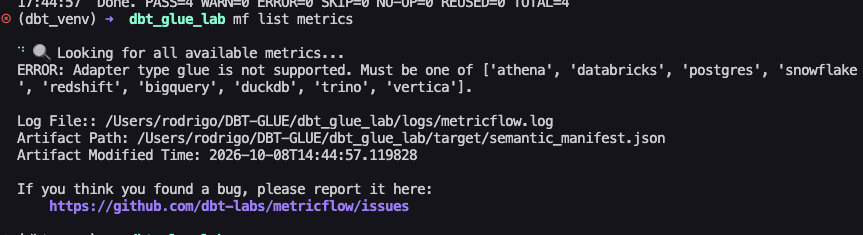

# Evidencias: MetricFlow (`mf`) no se puede ejecutar con el adaptador dbt-glue

Fecha: 2026-10-08
Proyecto: `DBT-GLUE/dbt_glue_lab` (perfil `dbt_glue_lab`, adaptador `glue`, dbt-glue 1.10.15)

## Resumen

El comando `mf` (CLI de MetricFlow, paquete `dbt-metricflow`) **no puede ejecutarse contra un proyecto dbt que usa el adaptador `glue`**. No es un problema de la capa semántica ni de la configuración del proyecto: `mf` sólo acepta una lista cerrada de adaptadores y `glue` no está en ella.

---

## Evidencia 1: error al ejecutar `mf list metrics`

Ejecución en la terminal del proyecto, con el entorno virtual `dbt_venv` activo y el `profiles.yml` de Glue:

```
(dbt_venv) ➜ dbt_glue_lab mf list metrics

⠙ 🔍 Looking for all available metrics...
ERROR: Adapter type glue is not supported. Must be one of ['athena', 'databricks', 'postgres', 'snowflake', 'redshift', 'bigquery', 'duckdb', 'trino', 'vertica'].

Log File:: /Users/rodrigo/DBT-GLUE/dbt_glue_lab/logs/metricflow.log
Artifact Path: /Users/rodrigo/DBT-GLUE/dbt_glue_lab/target/semantic_manifest.json
Artifact Modified Time: 2026-10-08T14:44:57.119828
```

Captura de pantalla original:



**Explicación**

- El mensaje dice textualmente `Adapter type glue is not supported` y enumera los adaptadores que sí acepta.
- Antes del error, el proyecto ya se había parseado bien: la última línea de `dbt` en la captura muestra `PASS=4 WARN=0 ERROR=0 SKIP=0 NO-OP=0 REUSED=0 TOTAL=4`.
- Existe el archivo `target/semantic_manifest.json` (ruta y fecha en el propio mensaje), es decir, **la capa semántica sí se generó**. El fallo ocurre después, cuando `mf` intenta construir el cliente SQL para el adaptador del perfil.

---

## Evidencia 2: el código fuente de `dbt-metricflow` lo confirma

En el paquete `dbt-metricflow` (versión 0.15.0, con `metricflow` 0.213.0), archivo `dbt_metricflow/cli/dbt_connectors/adapter_backed_client.py`:

```python
class SupportedAdapterTypes(enum.Enum):
    """Enumeration of supported dbt adapter types."""

    ATHENA = "athena"
    DATABRICKS = "databricks"
    POSTGRES = "postgres"
    SNOWFLAKE = "snowflake"
    REDSHIFT = "redshift"
    BIGQUERY = "bigquery"
    DUCKDB = "duckdb"
    TRINO = "trino"
    VERTICA = "vertica"
```

```python
def __init__(self, adapter: BaseAdapter):
    self._adapter = adapter
    try:
        adapter_type = SupportedAdapterTypes(self._adapter.type())
    except ValueError as e:
        raise ValueError(
            f"Adapter type {self._adapter.type()} is not supported. Must be one "
            f"of {[item.value for item in SupportedAdapterTypes]}."
        ) from e
```

**Explicación**

- `mf` toma el tipo de adaptador del perfil (`self._adapter.type()`; en este proyecto es `glue`) y lo busca en la enumeración `SupportedAdapterTypes`.
- `glue` no está en la enumeración, por lo que se lanza el `ValueError` cuyo texto coincide exactamente con el error de la Evidencia 1.
- Cada adaptador soportado tiene asociado su motor SQL y su renderizador de planes, y `glue` no tiene ninguno. Por eso no basta con configurar el proyecto de otra forma.
- Esto afecta a **todos** los comandos `mf` que usan el adaptador, incluidos `list`, `query --explain` y `validate-configs`, no sólo a `list metrics`.

---

## Conclusión

| Pregunta | Respuesta |
|---|---|
| ¿La capa semántica está bien definida? | Sí. `dbt parse` genera `semantic_manifest.json` sin errores. |
| ¿Se puede ejecutar `mf` con el perfil de Glue? | **No.** `glue` no está entre los adaptadores soportados por `dbt-metricflow`. |
| ¿Es un error de configuración del proyecto? | No. Es una limitación de la herramienta. |

## Alternativas

1. **Perfil auxiliar DuckDB, sólo para generar SQL** (ya incluido en `mf_profiles/profiles.yml`; ver README). Sirve para revisar la lógica de las métricas, pero el SQL sale en dialecto DuckDB y no se puede ejecutar contra los datos de Glue.
2. **Perfil Athena** (soportado por `mf`): consulta las tablas del Glue Data Catalog, incluidas las Iceberg, y permitiría ejecutar las métricas de verdad. Requiere `dbt-athena-community`, un workgroup y un bucket de resultados. No se ha probado en este proyecto.
