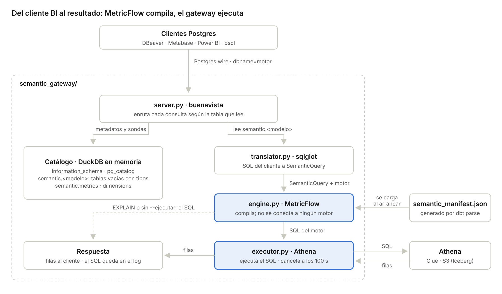

# MetricFlow: capa semántica, gateway y manifests

Repositorio de la capa semántica: proyectos dbt que definen las métricas, el **gateway semántico** que las publica
por protocolo PostgreSQL, scripts de apoyo y los `semantic_manifest.json` de cada proyecto.

El gateway **compila** cada consulta con MetricFlow al SQL del motor elegido (Athena, Snowflake, Redshift…). Por
defecto devuelve ese SQL; con `--ejecutar` lo **ejecuta en Athena** y devuelve las filas, dejando el SQL en el log.



El recorrido completo de una consulta, pieza por pieza, y la cobertura del ADR están en
[docs/arquitectura_gateway.md](docs/arquitectura_gateway.md).

## Estructura

```
MetricFlow/                              # raíz del repositorio git
├── semantic_gateway/                    # servidor del gateway
│   ├── model.py                         #   estructuras: TableInfo, Catalog, SemanticQuery
│   ├── translator.py                    #   SQL del cliente -> consulta semántica (sqlglot)
│   ├── engine.py                        #   MetricFlow como compilador; una tabla por modelo semántico
│   ├── executor.py                      #   ejecuta en Athena el SQL compilado (--ejecutar)
│   └── server.py                        #   protocolo Postgres (buenavista), catálogo DuckDB, compatibilidad BI
├── tests/                               # test_translator.py, test_gateway.py
├── script/
│   ├── compilar_sin_conexion.py         # compila una consulta a SQL sin gateway ni conexión
│   └── manifest_para_snowflake.py       # reescribe las rutas del manifest para Snowflake
├── semantic_manifests/                  # un semantic_manifest.json por proyecto dbt
│   ├── dbt_glue_lab/
│   │   ├── semantic_manifest.json
│   │   └── CONSULTAS.md                 #   consultas para DBeaver, su SQL de Athena y qué devuelven
│   └── it-people/
│       ├── semantic_manifest.json
│       └── CONSULTAS.md
├── notebooks/sqlglot_paso_a_paso.ipynb  # recorrido del traductor
├── docs/gateway_semantico.md            # documentación completa del gateway
├── docs/arquitectura_gateway.md         # flujo de una consulta, diagramas y cobertura del ADR
├── docs/consultas.md                    # consultas de ejemplo con su descripción
├── requirements-gateway.txt
└── DBT/
    └── dbt_glue_lab/                    # proyecto dbt (Glue + Iceberg) con su capa semántica
```

| Carpeta | Documentación |
| --- | --- |
| `semantic_gateway/`, `tests/`, `notebooks/` | [docs/gateway_semantico.md](docs/gateway_semantico.md) (instalación, uso y referencia) |
| Cómo funciona el gateway por dentro y cobertura del ADR | [docs/arquitectura_gateway.md](docs/arquitectura_gateway.md) |
| Consultas de ejemplo para DBeaver y Metabase (ambos manifests) | [docs/consultas.md](docs/consultas.md) |
| `DBT/dbt_glue_lab/` | [DBT/dbt_glue_lab/README.md](DBT/dbt_glue_lab/README.md) (incluye el estado frente al ADR, sección 15) |
| Consultas por manifest | [dbt_glue_lab](semantic_manifests/dbt_glue_lab/CONSULTAS.md) · [it-people](semantic_manifests/it-people/CONSULTAS.md) |

## Flujo de un manifest

```
DBT/<proyecto>/models/*.yml ──dbt parse──► DBT/<proyecto>/target/semantic_manifest.json
                                                 │ cp
                                                 ▼
                         semantic_manifests/<proyecto>/semantic_manifest.json ──► gateway / scripts
```

Cada proyecto dbt genera su manifest en su `target/` (que no se versiona). Se copia a `semantic_manifests/`, que
sí se versiona y es de donde lo leen el gateway y los scripts. Para un proyecto externo (por ejemplo IT People),
basta con dejar su `semantic_manifest.json` en `semantic_manifests/<proyecto>/`.

## Instalación

```bash
cd ~/DBT-GLUE
python3 -m venv dbt_venv                     # una vez
source dbt_venv/bin/activate
python3 -m pip install "dbt-core>=1.12" "dbt-glue>=1.12.4" dbt-metricflow dbt-duckdb
cd MetricFlow
python3 -m pip install -r requirements-gateway.txt
```

## Comandos

Todos desde la raíz `MetricFlow/`, salvo `dbt parse`.

```bash
# 1. Generar y publicar el manifest de dbt_glue_lab
cd DBT/dbt_glue_lab
unset DBT_PROFILES_DIR && dbt parse
cp target/semantic_manifest.json ../../semantic_manifests/dbt_glue_lab/semantic_manifest.json
cd ../..

# 2. Pruebas del gateway
python -m tests.test_translator
python -m tests.test_gateway

# 3. Levantar el gateway (uno por manifest; puertos distintos si van a la vez)
python -m semantic_gateway --manifest semantic_manifests/dbt_glue_lab/semantic_manifest.json --motor athena
python -m semantic_gateway --manifest semantic_manifests/it-people/semantic_manifest.json --motor athena --port 5434
#    para Metabase en Docker agregar: --host 0.0.0.0

# 3b. Levantar el gateway ejecutando en Athena (devuelve filas; el SQL queda en el log)
aws sso login --profile lab
python -m semantic_gateway --manifest semantic_manifests/dbt_glue_lab/semantic_manifest.json --motor athena \
  --ejecutar --aws-profile lab --region us-east-1 \
  --athena-workgroup primary --athena-output s3://<BUCKET>/athena-results/
#    opcionales: --timeout 100 (cancela en Athena al vencer), --max-filas N (0 = sin límite)

# 4. Compilar una consulta sin gateway
python3 script/compilar_sin_conexion.py --motor athena --metrics event_count --group-by event__platform
python3 script/compilar_sin_conexion.py --manifest semantic_manifests/it-people/semantic_manifest.json \
  --motor athena --metrics dotacion_total,ratio_internos --group-by employee__position
```

## Conexión desde DBeaver o Metabase

| Campo | Valor |
| --- | --- |
| Tipo | PostgreSQL |
| Host | `127.0.0.1` (Metabase en Docker: `host.docker.internal`) |
| Puerto | `5433`, o el de `--port` |
| Base de datos | Motor del SQL: `athena`, `snowflake`, `redshift`, `databricks`, `trino`, `bigquery`, `postgres`, `duckdb` |
| Usuario / contraseña | `bi` / `bi` (solo pruebas locales) |
| SSL | Desactivado |

```sql
SELECT table_name FROM information_schema.tables WHERE table_schema = 'semantic';  -- qué cargó el gateway
SELECT metric, label, type, table_name FROM semantic.metrics;                      -- métricas disponibles
SELECT event__platform, event_count FROM semantic.events;                         -- filas (con --ejecutar) o el SQL
EXPLAIN SELECT event__platform, event_count FROM semantic.events;                 -- siempre el SQL, sin ejecutar
```

Para ejecutar en Athena, la máquina del gateway necesita credenciales de AWS con permisos de Athena, Glue y S3 (datos
y ubicación de resultados). Configuración, permisos IAM y costo: [docs/gateway_semantico.md, sección
10.6](docs/gateway_semantico.md#106-ejecutar-en-athena-y-devolver-filas).

Si dos gateways quedan escuchando en el mismo puerto (en Windows ocurre sin aviso), DBeaver puede conectarse al
viejo: revisar con `netstat -ano | findstr :5433` (Windows) o `lsof -i :5433` (Mac) y cerrar el que sobra.
