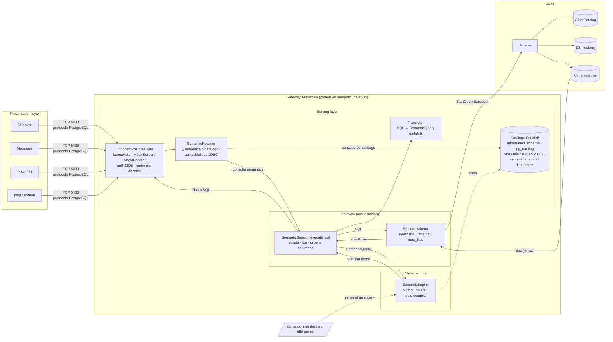
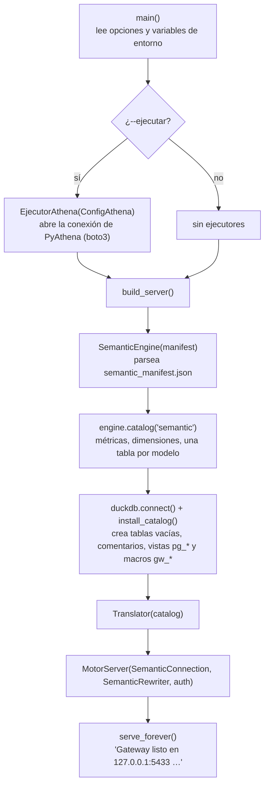
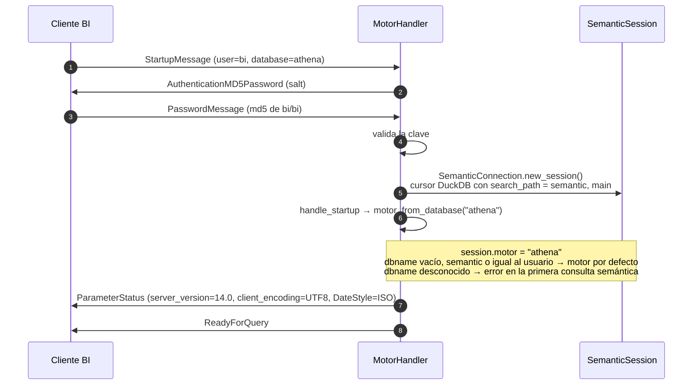
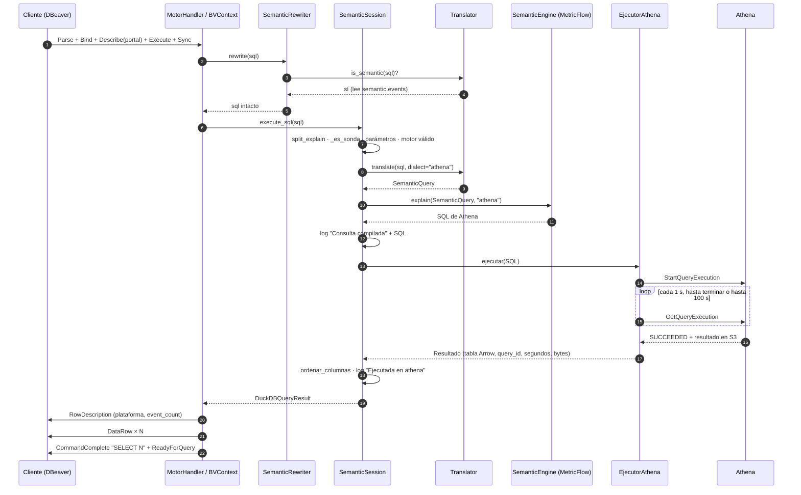
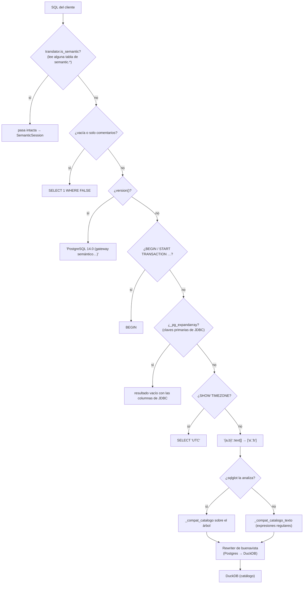
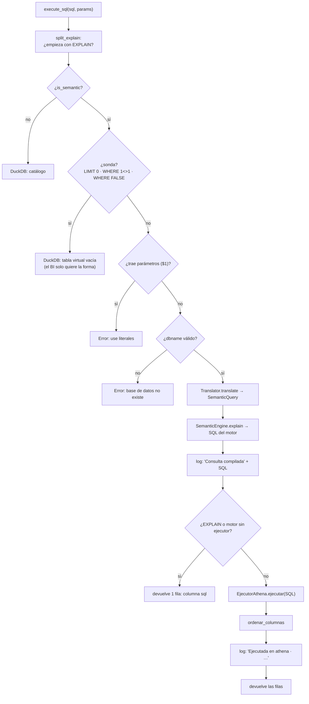
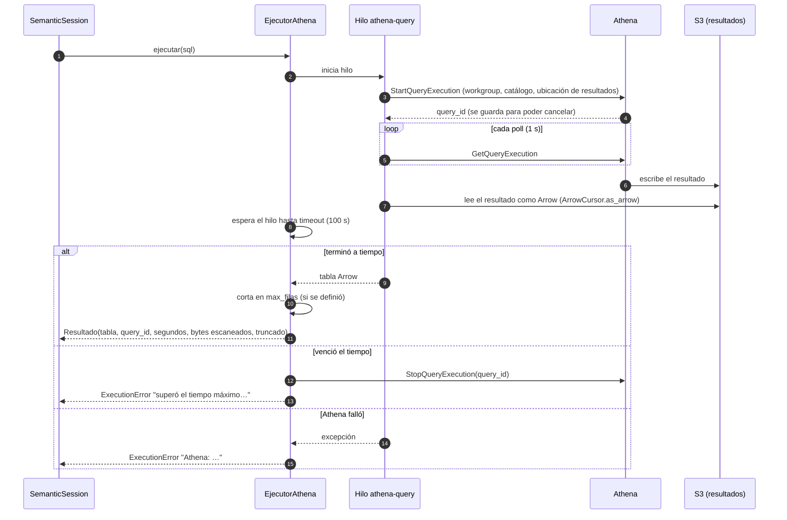
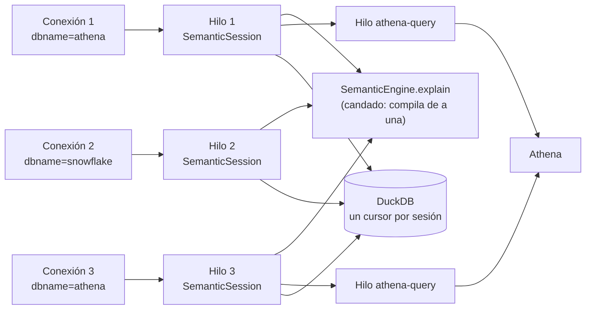

# Arquitectura del gateway semántico: de la consulta al resultado

Este documento explica cómo funciona cada pieza del gateway y qué le pasa a una consulta desde que una herramienta BI
la envía hasta que recibe el resultado. Al final se compara lo construido con el ADR de la capa semántica.

Para instalar, levantar y consultar el gateway, ver [gateway_semantico.md](gateway_semantico.md). Este documento se
centra en el **cómo funciona por dentro**.

> **Diagramas con lupa.** Para acercar y mover los diagramas, abrir [arquitectura_gateway.html](arquitectura_gateway.html)
> en el navegador: rueda para zoom, arrastrar para moverse, doble clic para ajustar. En GitHub, los diagramas de este
> documento también muestran controles de zoom al pasar el mouse.

## Índice

1. [Resumen](#1-resumen)
2. [Diagrama de arquitectura](#2-diagrama-de-arquitectura)
3. [Las piezas](#3-las-piezas)
4. [Arranque del gateway](#4-arranque-del-gateway)
5. [Conexión de un cliente](#5-conexión-de-un-cliente)
6. [Flujo de una consulta, paso a paso](#6-flujo-de-una-consulta-paso-a-paso)
7. [Rutas posibles de una consulta](#7-rutas-posibles-de-una-consulta)
8. [Errores: dónde nacen y cómo llegan al cliente](#8-errores-dónde-nacen-y-cómo-llegan-al-cliente)
9. [Concurrencia](#9-concurrencia)
10. [Cobertura del ADR](#10-cobertura-del-adr)
11. [Mapa de archivos y funciones](#11-mapa-de-archivos-y-funciones)

---

## 1. Resumen

El gateway es un proceso Python que **se hace pasar por un servidor PostgreSQL**. Las herramientas BI (DBeaver,
Metabase, Power BI, psql) se conectan a él como a cualquier Postgres y ven un esquema `semantic` con una tabla por
modelo semántico. Cada columna de esas tablas es una métrica o una dimensión.

Cuando el cliente consulta una de esas tablas, el gateway:

1. **traduce** el SQL del cliente a una consulta semántica (métricas, dimensiones, filtros, orden, límite);
2. **compila** esa consulta con MetricFlow al SQL del motor (Athena, Snowflake…), sin conectarse a nada;
3. **ejecuta** ese SQL en Athena (si se levantó con `--ejecutar`) y devuelve las filas, o devuelve el SQL compilado.

Todo lo demás que el cliente pregunta (qué tablas hay, qué columnas, tipos, versión del servidor) lo responde un
**catálogo en memoria** en DuckDB, sin tocar el warehouse.

---

## 2. Diagrama de arquitectura



🔍 [Abrir en el visor con zoom](arquitectura_gateway.html#01_arquitectura)

Lectura del diagrama:

- **Serving layer**: habla con los clientes (protocolo, autenticación, traducción y catálogo).
- **Gateway**: decide qué hacer con cada consulta, ejecuta en el motor y registra lo que pasó.
- **Metric engine**: MetricFlow, usado solo como compilador. Nunca abre conexiones.
- **AWS**: Athena ejecuta sobre las tablas Iceberg registradas en Glue y deja el resultado en S3.

---

## 3. Las piezas

| Pieza | Archivo | Capa del ADR | Qué hace |
| --- | --- | --- | --- |
| `MotorServer` | `server.py` | Serving | Servidor TCP de buenavista. Acepta conexiones y abre **un hilo por conexión** |
| `MotorHandler` | `server.py` | Serving | Maneja el protocolo de una conexión: arranque, autenticación MD5, mensajes de consulta. Fija el motor de la sesión según `dbname` |
| `BVContext` | buenavista | Serving | Estado de una conexión: sentencias preparadas, portales y caché de resultados del protocolo extendido |
| `SemanticRewriter` | `server.py` | Serving | Primer filtro de cada consulta: deja pasar intactas las semánticas y adapta las de catálogo al dialecto de DuckDB |
| Catálogo DuckDB | `server.py` (`install_catalog`) | Serving | Base DuckDB en memoria con `information_schema`, `pg_catalog`, las tablas virtuales vacías y las tablas `semantic.metrics`, `dimensions`, `metric_dimensions` |
| `SemanticSession` | `server.py` | Gateway | Sesión de una conexión. `execute_sql` decide la ruta: catálogo, SQL compilado o ejecución en Athena |
| `Translator` | `translator.py` | Serving | Convierte el `SELECT` del cliente en un `SemanticQuery`, validando el contrato |
| `SemanticQuery` | `model.py` | Contrato | La consulta semántica: métricas, `group_by`, filtros, rango de tiempo, orden, límite y columnas de salida |
| `SemanticEngine` | `engine.py` | Metric engine | Carga el manifest, arma el catálogo y compila con MetricFlow al dialecto pedido |
| `ClienteSqlSoloDialecto` | `engine.py` | Metric engine | Cliente SQL falso que solo aporta el dialecto: MetricFlow no puede ejecutar nada |
| `EjecutorAthena` | `executor.py` | Gateway | Ejecuta el SQL compilado en Athena con PyAthena y devuelve una tabla Arrow; cancela al vencer el tiempo máximo |
| `ordenar_columnas` | `executor.py` | Serving | Deja las columnas del resultado en el orden y con los alias del `SELECT` del cliente |

---

## 4. Arranque del gateway

```bash
python -m semantic_gateway --manifest semantic_manifests/dbt_glue_lab/semantic_manifest.json --motor athena --ejecutar ...
```



🔍 [Abrir en el visor con zoom](arquitectura_gateway.html#02_arranque)

Qué queda en memoria después de arrancar:

| Objeto | Contenido | Se comparte entre conexiones |
| --- | --- | --- |
| `SemanticEngine` | El manifest parseado y un `MetricFlowEngine` por motor (se crea la primera vez que se pide ese motor) | Sí, con candado para compilar |
| `Catalog` | Métricas, dimensiones y tablas virtuales (`events`, `items`, `top_items`…) | Sí, solo lectura |
| Base DuckDB | El catálogo SQL que ven los clientes | Sí; cada conexión abre su propio cursor |
| `Translator` | Reglas del contrato SQL sobre ese catálogo | Sí, sin estado |
| Ejecutores | `{"athena": EjecutorAthena}` si se usó `--ejecutar` | Sí; un cursor de Athena por consulta |

El manifest se lee **una sola vez**. Si cambia, hay que reiniciar el gateway.

**Cómo se arma el catálogo** (`SemanticEngine.catalog` y `_tables`):

1. MetricFlow lista las métricas del manifest (nombre, etiqueta, tipo, descripción).
2. Para cada métrica pide sus dimensiones compatibles (`simple_dimensions_for_metrics`) y agrega `metric_time` con
   sus granularidades (`__day`, `__week`, `__month`, `__quarter`, `__year`).
3. Agrupa las métricas por el modelo semántico del que salen (`get_derived_from_semantic_models`). Cada grupo es una
   tabla virtual. Una métrica que mezcla varios modelos va a una tabla con los nombres unidos por `_`.
4. Las columnas de cada tabla son sus métricas más las dimensiones **comunes a todas ellas**, así que cualquier
   combinación de columnas de una tabla es consultable.
5. `install_catalog` crea esas tablas en DuckDB, vacías y con tipos (`DATE` para tiempo, `VARCHAR` para el resto de
   dimensiones, `DOUBLE` para métricas), con la descripción de cada columna como comentario.

---

## 5. Conexión de un cliente



🔍 [Abrir en el visor con zoom](arquitectura_gateway.html#03_conexion)

Cada conexión tiene su propia `SemanticSession` y su propio motor. Una conexión con `dbname=athena` y otra con
`dbname=snowflake` pueden convivir: la primera recibe filas de Athena y la segunda, SQL de Snowflake.

---

## 6. Flujo de una consulta, paso a paso

Ejemplo que se sigue en toda la sección, enviado desde DBeaver con `dbname=athena` y el gateway levantado con
`--ejecutar`:

```sql
SELECT event__platform AS plataforma, event_count
FROM semantic.events
WHERE metric_time >= '2024-01-01' AND event__platform <> 'web'
ORDER BY event_count DESC
LIMIT 5
```

### 6.1 Vista general



🔍 [Abrir en el visor con zoom](arquitectura_gateway.html#04_flujo_consulta)

### 6.2 Paso 1 — El cliente envía la consulta (protocolo)

Hay dos formas de enviar una consulta en el protocolo PostgreSQL, y el gateway acepta ambas:

| Protocolo | Lo usan | Mensajes | Dónde entra en el gateway |
| --- | --- | --- | --- |
| Simple | psql, algunos pings | `Query` | `MotorHandler.handle_query` |
| Extendido | JDBC (DBeaver, Metabase), psycopg | `Parse` → `Bind` → `Describe` → `Execute` → `Sync` | `handle_parse`, `handle_bind`, `handle_describe`, `handle_execute` (buenavista) |

En el protocolo extendido, `Describe` del portal **ejecuta** la consulta para conocer sus columnas y guarda el
resultado en `BVContext.result_cache`. El `Execute` siguiente envía las filas de esa caché, así que la consulta va a
Athena **una sola vez**.

`MotorHandler.handle_query` intercepta además el caso de una consulta vacía (`;`), que los drivers JDBC usan como
ping, y responde `EmptyQueryResponse` sin pasar por el resto.

### 6.3 Paso 2 — `SemanticRewriter.rewrite`: ¿semántica o catálogo?

Toda consulta pasa primero por el rewriter. Su trabajo es separar las consultas semánticas, que pasan **intactas**,
de las de catálogo, que se adaptan para que DuckDB las entienda.



🔍 [Abrir en el visor con zoom](arquitectura_gateway.html#05_rewriter)

`_compat_catalogo` adapta lo que los drivers piden y DuckDB no tiene:

| Lo que pide el cliente | Cómo lo resuelve el gateway |
| --- | --- |
| `x::regclass`, `::regnamespace`, `::regtype` | Subconsulta sobre `pg_class`, `pg_namespace` o `pg_type` |
| `has_table_privilege(...)` y similares | `TRUE` (no hay permisos de catálogo) |
| `pg_get_expr`, `pg_get_partkeydef`, `pg_relation_size`, `pg_get_keywords()`… | Macros propias `gw_*` en DuckDB |
| `pg_type`, `pg_attribute`, `pg_database`, `pg_settings` | Vistas propias `gw_pg_*` con los OID y columnas que esperan los drivers |
| `pg_trigger`, `pg_roles`, `pg_extension`, `pg_matviews`, `pg_stat_*` | Vistas vacías con las columnas esperadas |

En el ejemplo, la consulta lee `semantic.events`, así que pasa intacta.

### 6.4 Paso 3 — `SemanticSession.execute_sql`: decidir la ruta



🔍 [Abrir en el visor con zoom](arquitectura_gateway.html#06_execute_sql)

### 6.5 Paso 4 — `Translator.translate`: del SQL a la consulta semántica

El traductor analiza el SQL con **sqlglot** y lo convierte en un `SemanticQuery`. Valida el contrato en el camino:

| Parte del SQL | Regla | En el ejemplo |
| --- | --- | --- |
| `FROM` | Una sola tabla de `semantic.*`. Sin `JOIN`, subconsultas, `WITH`, `HAVING` ni `OFFSET` | `events` |
| `SELECT` | Solo columnas de esa tabla, con alias opcional. Una métrica envuelta en `SUM/MAX/MIN/AVG` se acepta y el envoltorio se ignora (la agregación la decide MetricFlow). Sin `*` ni expresiones | `event__platform AS plataforma` → dimensión; `event_count` → métrica |
| `GROUP BY` | Implícito: todas las dimensiones del `SELECT` | `event__platform` |
| `WHERE` sobre `metric_time*` con `>=`, `<=`, `=` o `BETWEEN` y una fecha | Se convierte en **rango de tiempo** (`start`/`end`), no en filtro | `metric_time >= '2024-01-01'` → `start = 2024-01-01` |
| Resto del `WHERE` | Filtro de MetricFlow, cada columna reescrita como `{{ Dimension('…') }}` en el dialecto del motor. No se puede filtrar por métricas | `event__platform <> 'web'` → `{{ Dimension('event__platform') }} <> 'web'` |
| `ORDER BY` | Por nombre, alias u ordinal; la columna debe estar en el `SELECT` | `event_count DESC` → `-event_count` |
| `LIMIT` | Entero | `5` |

Resultado del ejemplo:

```python
SemanticQuery(
    metrics=['event_count'],
    group_by=['event__platform'],
    where=["{{ Dimension('event__platform') }} <> 'web'"],
    start=date(2024, 1, 1), end=None,
    order_by=['-event_count'],
    limit=5,
    output=[('event__platform', 'plataforma'), ('event_count', 'event_count')],
)
```

`output` guarda el orden y los alias del `SELECT`. Se usa al final para devolver las columnas como las pidió el
cliente.

¿Por qué el rango de tiempo no es un filtro? MetricFlow aplica `time_constraint` antes de calcular, y así las métricas
con ventanas (por ejemplo, comparar con el año anterior) pueden leer los datos que necesitan fuera del rango pedido.

### 6.6 Paso 5 — `SemanticEngine.explain`: compilar con MetricFlow

`explain` convierte el `SemanticQuery` en un `MetricFlowQueryRequest` y le pide a MetricFlow el plan de la consulta.

- Usa un `MetricFlowEngine` por motor, creado con `ClienteSqlSoloDialecto(motor)`: un cliente SQL que solo aporta el
  dialecto (renderer de Athena, Snowflake…). Si algo intentara ejecutar, fallaría.
- MetricFlow resuelve el grafo semántico: qué tabla física lee cada métrica, cómo se agregan, qué joins hacen falta y
  cómo se calculan ratios y métricas derivadas.
- Las compilaciones se hacen de a una (candado), porque todas las conexiones comparten los mismos `MetricFlowEngine`.

SQL que devuelve para el ejemplo (dialecto Athena):

```sql
SELECT
  event__platform
  , COUNT(DISTINCT event_count) AS event_count
FROM (
  SELECT
    platform AS event__platform
    , event_id AS event_count
  FROM lab_data_silver.silver_event events_src_10000
  WHERE DATE_TRUNC('day', event_date) BETWEEN timestamp '2024-01-01' AND timestamp '2040-12-31'
) subq_4
WHERE event__platform <> 'web'
GROUP BY
  event__platform
ORDER BY event_count DESC
LIMIT 5
```

La tabla física (`lab_data_silver.silver_event`) sale del manifest, del `node_relation` de cada modelo semántico.

### 6.7 Paso 6 — `EjecutorAthena.ejecutar`: ejecutar en Athena



🔍 [Abrir en el visor con zoom](arquitectura_gateway.html#07_ejecutor_athena)

Detalles:

- La consulta corre en un **hilo aparte** para poder cortarla. Si vence `--timeout` (100 s por defecto), se llama a
  `StopQueryExecution`: Athena deja de escanear y de cobrar.
- `--max-filas` es opcional (0 = sin límite). Protege la memoria del gateway, no el costo: Athena cobra por datos
  escaneados, no por filas devueltas.
- Las credenciales son las de la máquina del gateway (perfil, variables o rol). Todas las conexiones las comparten.

### 6.8 Paso 7 — Devolver el resultado al cliente

1. `ordenar_columnas(tabla, sq.output)` reordena las columnas y les pone los nombres del `SELECT`. MetricFlow
   devuelve primero las dimensiones y después las métricas, y Athena las devuelve en minúsculas. En el ejemplo, la
   columna `event__platform` sale como `plataforma`.
2. El log registra la ejecución:
   ```
   INFO … Ejecutada en athena · query_id=1a2b… · 5 filas · 3.8 s · 12.3 MB escaneados
   ```
3. `SemanticSession` devuelve un `DuckDBQueryResult` armado sobre la tabla Arrow.
4. buenavista traduce cada tipo Arrow a un tipo PostgreSQL y envía:
   - `RowDescription`: nombres y tipos de columna;
   - un `DataRow` por fila (si el cliente pidió un máximo por lote, envía `PortalSuspended` y continúa en el siguiente
     `Execute`);
   - `CommandComplete` (`SELECT 5`) y `ReadyForQuery`.

Resultado en DBeaver:

| plataforma | event_count |
| --- | --- |
| android | … |
| ios | … |

---

## 7. Rutas posibles de una consulta

| Consulta | Ejemplo | Quién responde | ¿Va a Athena? |
| --- | --- | --- | --- |
| Catálogo | `SELECT * FROM information_schema.tables` | DuckDB | No |
| Metadatos semánticos | `SELECT metric, description FROM semantic.metrics` | DuckDB (`semantic.metrics` tiene filas reales) | No |
| Sonda del BI | `SELECT * FROM semantic.events WHERE 1<>1` o `LIMIT 0` | DuckDB: tabla virtual vacía | No |
| Ping | `;` o solo un comentario | `EmptyQueryResponse` o `SELECT 1 WHERE FALSE` | No |
| `EXPLAIN` semántico | `EXPLAIN SELECT event_count FROM semantic.events` | Traductor + MetricFlow: columna `sql` | No |
| Semántica, motor sin ejecutor | `dbname=snowflake` | Traductor + MetricFlow: columna `sql` | No |
| Semántica, gateway sin `--ejecutar` | cualquier `dbname` | Traductor + MetricFlow: columna `sql` | No |
| **Semántica con ejecutor** | `dbname=athena` y `--ejecutar` | Traductor + MetricFlow + Athena: **filas** | **Sí** |

---

## 8. Errores: dónde nacen y cómo llegan al cliente

Cualquier excepción dentro de `execute_sql` la convierte buenavista en un `ErrorResponse` de PostgreSQL. El cliente
lo muestra como un error SQL con el mensaje original.

| Dónde | Excepción | Ejemplos de mensaje |
| --- | --- | --- |
| Traductor | `TranslationError` | `SELECT * no está soportado…`, `La columna 'x' no está en la tabla 'events'; está en: items…`, `No se puede filtrar por la métrica…` |
| Sesión | `TranslationError` | `La capa semántica no admite parámetros…`, `Base de datos 'xyz' no existe…` |
| MetricFlow | excepciones de MetricFlow | Combinaciones de métrica y dimensión que el grafo semántico no puede resolver |
| Ejecutor | `ExecutionError` | `Athena: … AccessDenied …`, `TABLE_NOT_FOUND`, `La consulta superó el tiempo máximo de 100 s en Athena y se canceló` |
| Catálogo | errores de DuckDB | Funciones de `pg_catalog` que todavía no tienen equivalente |

Los errores del ejecutor quedan además en el log como `ERROR … Falló la ejecución en athena: …`.

---

## 9. Concurrencia



🔍 [Abrir en el visor con zoom](arquitectura_gateway.html#08_concurrencia)

- buenavista abre **un hilo por conexión**. Cada uno tiene su sesión, su cursor de DuckDB y su motor.
- La compilación con MetricFlow tarda milisegundos y se hace de a una.
- Las ejecuciones en Athena sí corren en paralelo: cada consulta usa su propio cursor y su propio hilo.
- Una consulta lenta solo bloquea a su conexión; las demás siguen respondiendo.

---

## 10. Cobertura del ADR

### 10.1 Flujo de consulta del ADR frente a lo implementado

El ADR define la ruta única de una consulta en siete pasos:

| # | Paso del ADR | Implementación | Estado |
| --- | --- | --- | --- |
| 1 | La presentation layer envía una petición al serving layer | Endpoint Postgres wire (`MotorServer`/`MotorHandler`), probado con DBeaver, Metabase, psql y Python | ✅ Cubierto |
| 2 | El serving layer autentica al consumidor y traduce la petición a una consulta semántica | Autenticación MD5 con un usuario fijo; traducción completa con `Translator` → `SemanticQuery` | 🟡 Traducción cubierta; autenticación mínima |
| 3 | El gateway autoriza, añade los filtros de seguridad (RLS, objeto, PII) y comprueba la caché | No hay autorización, RLS, PII ni caché | ❌ Pendiente |
| 4 | El gateway entrega la consulta al metric engine; MetricFlow la compila a SQL | `SemanticEngine.explain` con MetricFlow OSS embebido, solo compila | ✅ Cubierto |
| 5 | El gateway ejecuta el SQL en el compute engine con sus propios conectores (identidad, costo, auditoría) | `EjecutorAthena` con PyAthena, `timeout` que cancela en Athena y log de bytes escaneados. Solo Athena; una credencial para todos | 🟡 Parcial |
| 6 | El compute engine ejecuta el SQL sobre la storage layer | Athena sobre Iceberg en S3, registrado en Glue | ✅ Cubierto |
| 7 | Los resultados vuelven al gateway, que los audita y los guarda en caché; el serving layer los entrega | Se entregan al cliente con el orden y alias pedidos; el log registra cada consulta. Sin caché ni auditoría formal | 🟡 Parcial |

### 10.2 Componentes del ADR

| Capa | Componente del ADR | Implementación | Estado |
| --- | --- | --- | --- |
| Semantic models | Definición de métricas en dbt, `semantic_manifest.json` | YAML de dbt 1.12, `dbt parse`, manifests en `semantic_manifests/` | ✅ Cubierto |
| Serving | Endpoint Postgres wire | buenavista + catálogo DuckDB; compatibilidad JDBC para DBeaver y Metabase | ✅ Cubierto (PoC) |
| Serving | Traductor de peticiones (sqlglot) | `translator.py`, contrato `SemanticQuery` | ✅ Cubierto |
| Serving | Exponer el catálogo de métricas y dimensiones | Una tabla virtual por modelo semántico; `semantic.metrics`, `dimensions`, `metric_dimensions` | ✅ Cubierto |
| Serving | Autenticación OIDC/SAML, Entra ID | Usuario y clave MD5 fijos (`bi`/`bi`) | 🟡 Mínimo |
| Serving | API REST/GraphQL | — | ❌ Pendiente |
| Serving | Servidor MCP (agentes IA) | — | ❌ Pendiente |
| Serving | Arrow Flight SQL, XMLA/DAX | — (el ADR los deja para después del MVP) | ⏸ Fuera del MVP |
| Gateway | Inyección de seguridad (RLS, seguridad de objeto, PII) | — | ❌ Pendiente |
| Gateway | Caché de resultados (invalidación por snapshot de Iceberg o build de dbt) | — | ❌ Pendiente |
| Gateway | Conectores de motor y enrutador (workgroups, timeouts, límites de escaneo) | Athena: workgroup, `timeout` con cancelación, `max_filas`, log de bytes escaneados. El motor lo elige el cliente con `dbname`, no se enruta por producto de datos | 🟡 Parcial (solo Athena) |
| Gateway | Gestor del manifiesto (carga en caliente, versión por entorno) | Se lee del disco al arrancar | 🟡 Mínimo |
| Gateway | Auditoría y límites de costo | Log por consulta (motor, SQL, query_id, filas, segundos, bytes); sin registro de auditoría por usuario ni presupuesto | 🟡 Mínimo |
| Metric engine | MetricFlow OSS embebido, solo compila | `engine.py` con `ClienteSqlSoloDialecto`; ocho dialectos | ✅ Cubierto |
| Transversal | Validador del modelo en CI | `dbt parse` valida localmente; no hay pipeline de CI | ❌ Pendiente |
| Transversal | Sincronizador OpenMetadata | — | ❌ Pendiente |
| Transversal | Observabilidad (latencia, errores, costo y uso por métrica) | Solo el log del proceso | ❌ Pendiente |
| Operación | Alta disponibilidad, despliegue en AWS | Proceso local | ❌ Pendiente |

### 10.3 Principios del ADR

| Principio | Cómo se cumple hoy |
| --- | --- |
| **MetricFlow solo compila, no ejecuta** | `ClienteSqlSoloDialecto` hace imposible que MetricFlow ejecute; la ejecución la hace `executor.py` |
| **Los datos no se mueven (pushdown)** | Athena calcula sobre las tablas Iceberg; el gateway solo recibe el resultado agregado |
| **Métrica definida una sola vez** | Las métricas salen del manifest de dbt; el cliente no puede redefinir la agregación (`SUM(ratio)` se ignora y el ratio se calcula bien) |
| **Un único punto de acceso** | Todas las herramientas usan el mismo endpoint y el mismo catálogo |
| **Seguridad centralizada en el gateway** | Pendiente: no hay RLS ni permisos por usuario |

### 10.4 Próximos pasos sugeridos, en orden

1. **Seguridad en el gateway**: identidad del usuario (no una credencial compartida) y filtros RLS inyectados en el
   `SemanticQuery` antes de compilar.
2. **Auditoría**: registro estructurado por consulta (usuario, métricas, motor, query_id, bytes, duración).
3. **Caché de resultados** con invalidación por snapshot de Iceberg o por build de dbt.
4. **Gestor del manifiesto**: recarga en caliente desde S3 sin cortar conexiones.
5. **Más conectores**: Snowflake o Redshift con la misma interfaz `Ejecutor`, y enrutamiento por producto de datos.
6. **API REST y servidor MCP** sobre el mismo `SemanticQuery`.
7. **CI/CD, OpenMetadata y despliegue** con alta disponibilidad en AWS.

---

## 11. Mapa de archivos y funciones

| Paso del flujo | Archivo | Función o clase |
| --- | --- | --- |
| Arranque | `server.py` | `main`, `build_server`, `install_catalog`, `_install_pg_views` |
| Catálogo semántico | `engine.py` | `SemanticEngine.catalog`, `_tables` |
| Conexión y motor | `server.py` | `MotorHandler.handle_startup`, `motor_from_database`, `SemanticConnection.new_session` |
| Ping y consulta simple | `server.py` | `MotorHandler.handle_query`, `_consulta_vacia` |
| Clasificación y compatibilidad | `server.py` | `SemanticRewriter.rewrite`, `_compat_catalogo`, `_compat_catalogo_texto`, `_literales_arreglo` |
| Enrutamiento | `server.py` | `SemanticSession.execute_sql`, `_es_sonda` |
| Traducción | `translator.py` | `Translator.is_semantic`, `translate`, `_check_shape`, `_where`, `_time_constraint`, `_metricflow_filter`, `_order_name` |
| Contrato | `model.py` | `SemanticQuery`, `Catalog`, `TableInfo` |
| Compilación | `engine.py` | `SemanticEngine.explain`, `_request`, `ClienteSqlSoloDialecto` |
| Ejecución | `executor.py` | `EjecutorAthena.ejecutar`, `ConfigAthena`, `Resultado`, `ExecutionError` |
| Entrega | `executor.py`, buenavista | `ordenar_columnas`, `DuckDBQueryResult`, `send_row_description`, `send_data_rows` |

La referencia completa de cada función, con quién la llama, está en
[gateway_semantico.md, sección 19](gateway_semantico.md#19-referencia-de-funciones).
