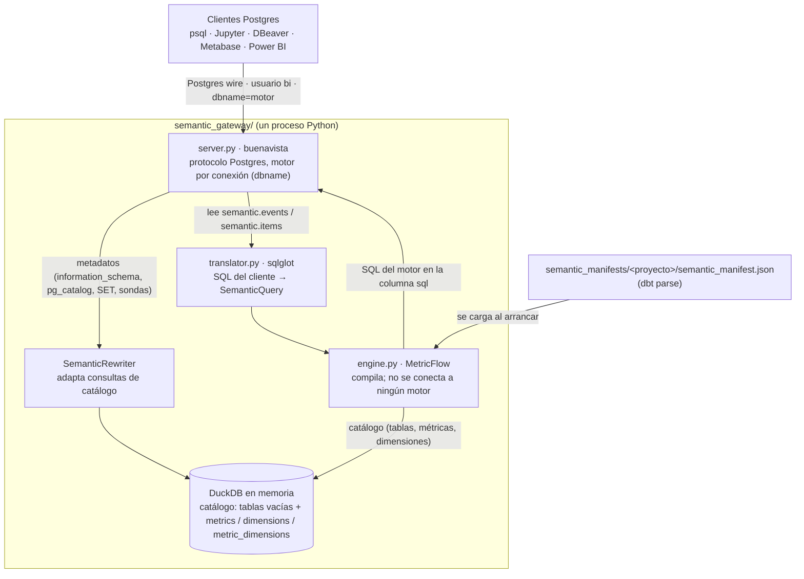

# Gateway semántico de dbt_glue_lab

Guía completa del gateway: qué publica, cómo está armado, cómo se instala, cómo se ejecuta y cómo se consume desde
psql, Jupyter, DBeaver y Metabase.

Todos los comandos se ejecutan desde la raíz del repositorio, `MetricFlow/` (en el Mac, `~/DBT-GLUE/MetricFlow`),
salvo `dbt parse`, que se ejecuta dentro de cada proyecto dbt (`DBT/dbt_glue_lab/`).

Actualizado el 10 de octubre de 2026.

> El recorrido detallado de una consulta por cada pieza, con diagramas, y la cobertura del ADR están en
> [arquitectura_gateway.md](arquitectura_gateway.md).

## Índice

1. [Qué es y qué hace hoy](#1-qué-es-y-qué-hace-hoy)
2. [Arquitectura](#2-arquitectura)
3. [Qué publica: tablas y catálogo](#3-qué-publica-tablas-y-catálogo)
4. [De dónde salen las tablas: la capa semántica en dbt](#4-de-dónde-salen-las-tablas-la-capa-semántica-en-dbt)
5. [Código: paquete `semantic_gateway`](#5-código-paquete-semantic_gateway)
6. [Recorrido de una consulta](#6-recorrido-de-una-consulta)
7. [Instalación](#7-instalación)
8. [Generar y validar el manifest](#8-generar-y-validar-el-manifest)
9. [Ejecutar las pruebas](#9-ejecutar-las-pruebas)
10. [Levantar el gateway](#10-levantar-el-gateway)
11. [Conectarse](#11-conectarse)
12. [Consultar: contrato SQL y ejemplos con respuesta](#12-consultar-contrato-sql-y-ejemplos-con-respuesta)
13. [Agregar métricas o modelos semánticos](#13-agregar-métricas-o-modelos-semánticos)
14. [Compatibilidad con clientes BI (JDBC)](#14-compatibilidad-con-clientes-bi-jdbc)
15. [Errores frecuentes](#15-errores-frecuentes)
16. [Limitaciones](#16-limitaciones)
17. [Correspondencia con el ADR y próximos pasos](#17-correspondencia-con-el-adr-y-próximos-pasos)
18. [Chuleta de comandos](#18-chuleta-de-comandos)
19. [Referencia de funciones](#19-referencia-de-funciones)

---

## 1. Qué es y qué hace hoy

El gateway es un servidor que **habla el protocolo de PostgreSQL** sin ser un PostgreSQL. Cualquier herramienta que
se conecte a Postgres (psql, psycopg, DBeaver, Metabase, Power BI) puede conectarse a él y consultar las métricas de
la capa semántica como si fueran columnas de una tabla.

| | Estado actual |
| --- | --- |
| Qué publica | Una tabla virtual por modelo semántico: `semantic.events` y `semantic.items` |
| Qué hace con una consulta semántica | La traduce y la **compila** con MetricFlow al dialecto pedido. Sin `--ejecutar`, devuelve el SQL en una columna `sql`. Con `--ejecutar`, las conexiones `dbname=athena` reciben las **filas** de Athena y el SQL queda en el log (sección 10.6) |
| Qué no hace | No ejecuta en motores distintos de Athena: para ellos devuelve el SQL |
| Motores (dialectos) | athena, bigquery, databricks, duckdb, postgres, redshift, snowflake, trino |
| Cómo se elige el motor | En cada conexión, con el nombre de la base de datos (`dbname=snowflake`) |
| Fuente de verdad | Un `semantic_manifest.json` de `semantic_manifests/` (uno por proyecto dbt), generado por `dbt parse`. Se lee una vez al arrancar |
| Clientes probados | psql/psycopg, Jupyter, Metabase (conexión, sincronización de esquema y SQL nativo) y las consultas de catálogo de DBeaver |

---

## 2. Arquitectura



Hay dos rutas:

- **Metadatos.** Cuando un cliente pregunta qué tablas o columnas existen, o envía comandos de sesión, responde
  DuckDB en memoria. Ahí viven las tablas virtuales vacías con sus tipos y las tablas de catálogo con filas reales.
- **Consultas semánticas.** Cuando la consulta lee `semantic.events` o `semantic.items`, no se lee ninguna tabla. El
  traductor convierte el SQL en una consulta semántica, MetricFlow la compila y el gateway devuelve el SQL.

Nada se persiste. El catálogo se reconstruye desde el manifest cada vez que el gateway arranca.

---

## 3. Qué publica: tablas y catálogo

Todo vive en el esquema `semantic`.

### 3.1 Tablas virtuales (una por modelo semántico)

Cada tabla contiene las métricas de un modelo semántico y **solo** las dimensiones que se pueden cruzar con todas
ellas. Por eso cualquier combinación de columnas de una misma tabla es consultable. Las tablas están vacías: sirven
como carta de lo que se puede pedir.

**`semantic.events`** (18 columnas): métricas de eventos, sobre `silver_event`.

| Tipo | Columnas |
| --- | --- |
| Métricas (`DOUBLE`) | `event_count`, `unique_users`, `item_views`, `profile_views`, `item_views_per_user`, `item_views_share`, `engagement_events` |
| Dimensiones (`VARCHAR`) | `event__event_name`, `event__platform`, `event__parameter_name`, `event__event_year` |
| Dimensiones (`DATE`) | `event__event_date`, `metric_time`, `metric_time__day`, `metric_time__week`, `metric_time__month`, `metric_time__quarter`, `metric_time__year` |

**`semantic.items`** (15 columnas): métricas de items, sobre `silver_item`.

| Tipo | Columnas |
| --- | --- |
| Métricas (`DOUBLE`) | `item_count`, `total_item_price`, `avg_item_price`, `max_item_price` |
| Dimensiones (`VARCHAR`) | `item__item_name`, `item__category`, `item__adjective`, `item__modifier` |
| Dimensiones (`DATE`) | `item__created_at_date`, `metric_time`, `metric_time__day`, `metric_time__week`, `metric_time__month`, `metric_time__quarter`, `metric_time__year` |

`metric_time` es la dimensión de tiempo común: en `events` corresponde a `event_date` y en `items` a
`created_at_date`. El modelo `top_items` no tiene métricas, así que no genera tabla.

### 3.2 Tablas de catálogo (con filas reales)

| Tabla | Columnas | Filas | Para qué |
| --- | --- | --- | --- |
| `semantic.metrics` | `metric`, `label`, `type`, `description`, `table_name` | 11 | Qué métricas hay, su tipo (simple, ratio, derived) y en qué tabla están |
| `semantic.dimensions` | `dimension`, `kind`, `data_type`, `description` | 16 | Qué dimensiones hay, si son de tiempo o categóricas, y su descripción del YAML |
| `semantic.metric_dimensions` | `metric`, `dimension` | 121 | Qué dimensiones admite cada métrica |

Ejemplos:

```sql
SELECT metric, label, type, table_name FROM semantic.metrics ORDER BY table_name, metric;
SELECT dimension, kind, description FROM semantic.dimensions;
SELECT dimension FROM semantic.metric_dimensions WHERE metric = 'total_item_price';
```

### 3.3 Tipos de columna

Sin conexión al warehouse no se conocen los tipos físicos. Se publican así: dimensiones de tiempo como `DATE`, el
resto de dimensiones como `VARCHAR` (por eso `event__event_year` aparece como texto) y las métricas como `DOUBLE`.

---

## 4. De dónde salen las tablas: la capa semántica en dbt

El gateway no lee YAML ni tablas: lee un único archivo, el `semantic_manifest.json` que se le indica con
`--manifest` (por ejemplo `semantic_manifests/dbt_glue_lab/semantic_manifest.json`). Ese archivo lo genera
`dbt parse` en el proyecto dbt (`DBT/dbt_glue_lab/target/`) a partir de estos YAML (spec nueva de dbt, 1.12 o superior):

| Pieza | Archivo | Contenido |
| --- | --- | --- |
| Modelo semántico `events` | `models/silver/schema.yml` (modelo `silver_event`) | Entidades `event` y `user`, tiempo `event_date`, dimensiones y las métricas simples `event_count`, `unique_users`, `item_views`, `profile_views` |
| Modelo semántico `items` | `models/silver/schema.yml` (modelo `silver_item`) | Entidad `item`, tiempo `created_at_date`, dimensiones y las métricas simples `item_count`, `total_item_price`, `avg_item_price`, `max_item_price` |
| Modelo semántico `top_items` | `models/gold/schema.yml` | Dimensiones de `gold_top_item`; sin métricas |
| Métricas ratio y derivadas | `models/semantic/metrics.yml` | `item_views_per_user`, `item_views_share`, `engagement_events` |
| Time spine | `models/semantic/metricflow_time_spine.sql` + `time_spine.yml` | Calendario diario 2010–2030 que MetricFlow necesita para `metric_time` |

Regla de la spec: las métricas simples van dentro del modelo (`metrics:` con `type: simple`, `agg` y `expr`); las de
tipo ratio, derived, cumulative o conversion van en un bloque `metrics:` de nivel superior.

**Cómo se arma cada tabla virtual** (código en `engine.py`, método `_tables`):

1. Para cada métrica, MetricFlow informa de qué modelo(s) semántico(s) sale
   (`metric_lookup.get_derived_from_semantic_models`). Las compuestas heredan los modelos de sus insumos: por eso
   `item_views_per_user` cae en `events`.
2. Las métricas se agrupan por modelo. El nombre de la tabla es el del modelo (`events`, `items`). Si una métrica
   mezcla varios modelos, va a una tabla propia llamada `modelo1_modelo2`.
3. Las dimensiones de la tabla son las **comunes a todas** sus métricas.
4. Los nombres `metrics`, `dimensions` y `metric_dimensions` están reservados para el catálogo; un modelo con ese
   nombre recibe el sufijo `_sm`.

---

## 5. Código: paquete `semantic_gateway`

```
MetricFlow/                         # raíz del repositorio
├── semantic_gateway/
│   ├── __init__.py          # documenta la arquitectura
│   ├── __main__.py          # permite: python -m semantic_gateway
│   ├── model.py             # estructuras de datos (contrato común)
│   ├── translator.py        # SQL del cliente → SemanticQuery (sqlglot)
│   ├── engine.py            # MetricFlow como compilador; arma el catálogo
│   ├── executor.py          # ejecuta en Athena el SQL compilado (opcional, --ejecutar)
│   └── server.py            # servidor Postgres (buenavista), catálogo DuckDB, compatibilidad BI
├── tests/
│   ├── test_translator.py   # pruebas del traductor, sin base de datos
│   └── test_gateway.py      # integración por protocolo Postgres
├── notebooks/
│   └── sqlglot_paso_a_paso.ipynb   # cómo sqlglot procesa una consulta, paso a paso
├── script/
│   ├── compilar_sin_conexion.py    # compila SQL con MetricFlow sin conexión
│   └── manifest_para_snowflake.py  # reescribe las rutas del manifest para Snowflake
├── semantic_manifests/             # un semantic_manifest.json por proyecto dbt
│   ├── dbt_glue_lab/semantic_manifest.json
│   └── it-people/semantic_manifest.json
├── requirements-gateway.txt
├── docs/gateway_semantico.md       # este documento
└── DBT/
    └── dbt_glue_lab/               # proyecto dbt (genera el manifest)
```

| Archivo | Líneas | Responsabilidad | Piezas clave |
| --- | --- | --- | --- |
| `model.py` | 81 | Estructuras de datos, sin lógica ni dependencias | `MetricInfo`, `DimensionInfo`, `TableInfo`, `Catalog`, `SemanticQuery`, `is_metric_time` |
| `translator.py` | 222 | SQL (dialecto Postgres) → `SemanticQuery` | `Translator.is_semantic`, `translate`, `_check_shape`, `_unknown_column`, `_where`, `_time_constraint`, `_metricflow_filter`, `split_explain` |
| `engine.py` | 174 | Carga el manifest, arma el catálogo y compila con MetricFlow sin conexión | `SemanticEngine.catalog`, `_tables`, `explain`, `ClienteSqlSoloDialecto`, `MOTORES`, `SQLGLOT_DIALECT` |
| `executor.py` | 133 | Ejecuta en Athena el SQL compilado y devuelve una tabla Arrow; tiempo máximo y límite de filas | `EjecutorAthena`, `ConfigAthena`, `Resultado`, `ExecutionError`, `ordenar_columnas` |
| `server.py` | 528 | Servidor, catálogo en DuckDB, motor por conexión, enrutamiento, compatibilidad JDBC, ejecución opcional | `build_server`, `install_catalog`, `SemanticSession.execute_sql`, `SemanticRewriter`, `MotorHandler`, `motor_from_database`, `main` |

La lista completa de clases y funciones, con quién las llama y su capa del ADR, está en la
[sección 19](#19-referencia-de-funciones).

### model.py

- `MetricInfo(name, label, type, description)` y `DimensionInfo(name, kind, data_type, description)`: lo que se
  publica de cada métrica y dimensión. Inmutables.
- `TableInfo(name, description, metrics, dimensions)`: una tabla virtual.
- `Catalog(schema, tables, metrics, dimensions, metric_dimensions)`: todo lo publicado. `is_metric(nombre, tabla)` e
  `is_dimension(nombre, tabla)` comprueban si una columna pertenece a una tabla; `tables_with(columna)` dice en qué
  tablas está; `table_of_metric(métrica)` dice a qué tabla pertenece.
- `SemanticQuery`: la consulta canónica que viaja del traductor al motor (`metrics`, `group_by`, `where`, `start`,
  `end`, `order_by`, `limit`, `output`).

### translator.py

- `is_semantic(sql)`: la consulta es semántica si lee alguna tabla virtual.
- `translate(sql, dialect)`: parsea con `sqlglot.parse_one`, llama a `_check_shape` (una sola tabla virtual, sin joins,
  subconsultas, `HAVING`, `OFFSET` ni `WITH`) y clasifica cada columna del `SELECT` como métrica o dimensión **de esa
  tabla**.
- `_unknown_column`: si la columna existe en otra tabla, el error lo dice: *La columna 'item__category' no está en la
  tabla 'events'; está en: items*.
- `_where` y `_time_constraint`: las condiciones sobre `metric_time*` con `>=`, `<=`, `=` o `BETWEEN` y fecha literal se
  convierten en rango de tiempo (`start`/`end`). El resto pasa por `_metricflow_filter`, que reescribe cada columna
  como `{{ Dimension('…') }}` o `{{ TimeDimension('…') }}` en el dialecto del motor.

### engine.py

- `SemanticEngine(manifest, motor)`: lee el manifest una vez. Crea un `MetricFlowEngine` por motor la primera vez que
  se pide.
- `ClienteSqlSoloDialecto`: le dice a MetricFlow qué dialecto usar. Si algo intentara ejecutar, falla.
- `catalog(schema)`: arma el `Catalog`, incluidas las tablas por modelo (`_tables`).
- `explain(sq, motor)`: devuelve el SQL compilado.

### server.py

- `build_server`: arma motor, catálogo, DuckDB, traductor y servidor.
- `install_catalog`: crea en DuckDB las tablas virtuales vacías, las tablas de catálogo y las vistas de compatibilidad
  que esperan los drivers.
- `MotorHandler` + `motor_from_database`: leen `dbname` al conectarse y fijan el motor de la sesión.
- `SemanticSession.execute_sql`: decide la ruta. Metadatos y sondas → DuckDB. Consulta semántica → traductor →
  `engine.explain` → imprime el SQL en el log → lo devuelve en la columna `sql`.
- `SemanticRewriter`: adapta al dialecto DuckDB las consultas de catálogo de los drivers (ver sección 14).
- `main`: argumentos de línea de comandos y variables de entorno.

---

## 6. Recorrido de una consulta

**Al arrancar (una vez)**

1. `SemanticEngine` lee `semantic_manifest.json`.
2. `engine.catalog("semantic")` arma el catálogo y las tablas por modelo.
3. `install_catalog` crea en DuckDB en memoria `semantic.events` (18 columnas), `semantic.items` (15),
   `semantic.metrics`, `semantic.dimensions`, `semantic.metric_dimensions` y las vistas de compatibilidad.
4. El servidor escucha en el puerto (5433 por defecto) y atiende cada conexión en un hilo.

**Al conectarse un cliente**

1. `MotorHandler` lee el mensaje de arranque y llama a `motor_from_database(dbname, usuario, motor_por_defecto)`.
2. Se valida la clave (MD5) y el log muestra: `Conexión · usuario=bi dbname=snowflake → motor=snowflake`.

**Por cada consulta**

1. `SemanticRewriter.rewrite` deja pasar intactas las consultas semánticas y adapta las de catálogo.
2. `SemanticSession.execute_sql` separa `EXPLAIN` y llama a `is_semantic`.
   - Si no es semántica (o es una sonda `LIMIT 0` / `WHERE 1<>1`), responde DuckDB.
   - Si es semántica, sigue.
3. `Translator.translate` produce el `SemanticQuery`, con los filtros en el dialecto del motor de la sesión.
4. `engine.explain(sq, motor)` compila con MetricFlow.
5. El SQL se imprime en el log (`Consulta compilada · motor=… ---------- SQL <motor> ----------`) y se devuelve como
   una fila con la columna `sql`.

---

## 7. Instalación

### 7.1 Requisitos

| Requisito | Detalle |
| --- | --- |
| Python | 3.10 o superior |
| dbt | dbt-core 1.12 o superior (spec semántica nueva) con dbt-glue 1.12.4 o superior |
| Red / AWS | **No** se necesitan para el gateway: compila sin conexión |
| Docker | Solo si vas a usar Metabase en contenedor |

### 7.2 Entorno virtual y dependencias

```bash
cd ~/DBT-GLUE
python3 -m venv dbt_venv
source dbt_venv/bin/activate

python3 -m pip install --upgrade pip
python3 -m pip install "dbt-core>=1.12" "dbt-glue>=1.12.4" dbt-metricflow dbt-duckdb   # dbt (README del proyecto dbt, sección 3)

cd MetricFlow
python3 -m pip install -r requirements-gateway.txt                                     # gateway
```

`requirements-gateway.txt`:

| Paquete | Para qué |
| --- | --- |
| `metricflow==0.213.0` | Motor de métricas, usado solo para compilar |
| `buenavista==0.5.0` | Servidor del protocolo Postgres, en Python puro |
| `sqlglot>=30` | Parser SQL del traductor y de la capa de compatibilidad |
| `pyarrow` | Formato de los resultados que se envían al cliente |
| `duckdb` | Catálogo en memoria |
| `psycopg[binary]>=3.2` | Cliente Postgres para las pruebas y para Jupyter |

Opcional, para los notebooks:

```bash
python3 -m pip install jupyterlab ipykernel
```

Comprobar:

```bash
dbt --version
python3 -c "import metricflow, buenavista, sqlglot, duckdb, psycopg; print('ok')"
```

Si `pip` falla con `CERTIFICATE_VERIFY_FAILED` (Python de python.org en macOS):

```bash
python3 -m pip install --upgrade certifi
export SSL_CERT_FILE=$(python3 -c "import certifi; print(certifi.where())")
export REQUESTS_CA_BUNDLE=$SSL_CERT_FILE
```

### 7.3 Clientes opcionales

| Cliente | Instalación |
| --- | --- |
| `psql` (macOS) | `brew install libpq` y luego `echo 'export PATH="/opt/homebrew/opt/libpq/bin:$PATH"' >> ~/.zshrc` |
| Metabase | `docker run -d -p 3000:3000 --name metabase metabase/metabase` y abrir http://localhost:3000 |
| DBeaver | Instalador oficial; usar el driver PostgreSQL |

---

## 8. Generar y validar el manifest

Desde el proyecto dbt (`MetricFlow/DBT/dbt_glue_lab/`), con el entorno activo:

```bash
unset DBT_PROFILES_DIR        # usar el perfil de Glue (profiles.yml del proyecto)
dbt parse                     # escribe target/semantic_manifest.json; no se conecta a Glue
cp target/semantic_manifest.json ../../semantic_manifests/dbt_glue_lab/semantic_manifest.json   # publicarlo para el gateway
```

Para otro proyecto dbt, el manifest va en su propia carpeta: `semantic_manifests/<proyecto>/semantic_manifest.json`.

Validar la capa semántica con MetricFlow (perfil DuckDB local, ver [README del proyecto dbt](../DBT/dbt_glue_lab/README.md), sección 10):

```bash
export DBT_PROFILES_DIR=$PWD/mf_profiles
dbt parse
mf validate-configs --skip-dw
unset DBT_PROFILES_DIR
dbt parse                     # volver a generar el manifest con el perfil de Glue
```

El gateway usa las rutas de tabla del manifest tal cual (`lab_data_silver.silver_event`). Por eso conviene que el
último `dbt parse` sea con el perfil de Glue.

Ver qué quedó en el manifest:

```bash
python3 -c "
import json
m = json.load(open('semantic_manifests/dbt_glue_lab/semantic_manifest.json'))
print('modelos:', [s['name'] for s in m['semantic_models']])
print('métricas:', [x['name'] for x in m['metrics']])
"
```

---

## 9. Ejecutar las pruebas

Desde la raíz `MetricFlow/` (usan `semantic_manifests/dbt_glue_lab/semantic_manifest.json`):

```bash
python -m tests.test_translator     # 5 pruebas del traductor, sin base de datos
python -m tests.test_gateway        # levanta el gateway en un hilo y prueba por protocolo Postgres
```

Salida esperada de `test_gateway`:

```
OK · dbname=athena / snowflake / semantic
OK · conexiones simultáneas independientes
OK · dbname desconocido
OK · compatibilidad JDBC (ping, SHOW, parámetros)
OK · sincronización de metadatos tipo Metabase
OK · una tabla virtual por modelo semántico
OK · navegación tipo DBeaver
OK · gateway Postgres wire: motor por conexión
```

Durante `test_gateway` aparecen mensajes de error y un `WARNING` con una consulta: son los casos de error que la
prueba provoca a propósito.

---

## 10. Levantar el gateway

### 10.1 Local (clientes en la misma máquina)

```bash
cd ~/DBT-GLUE/MetricFlow
source ../dbt_venv/bin/activate
python -m semantic_gateway --manifest semantic_manifests/dbt_glue_lab/semantic_manifest.json --motor athena
```

### 10.2 Para clientes en Docker o en otra máquina (Metabase)

```bash
python -m semantic_gateway --manifest semantic_manifests/dbt_glue_lab/semantic_manifest.json --motor athena --host 0.0.0.0
```

`--host 0.0.0.0` acepta conexiones desde fuera de `localhost`. Sin TLS ni autenticación fuerte, úsalo solo en tu
máquina o en una red privada.

La terminal queda ocupada mientras el gateway corre; `Ctrl+C` lo detiene. Cuando está listo, muestra:

```
INFO semantic_gateway · Gateway listo en 0.0.0.0:5433 · semantic.{events, items} · motor por defecto=athena (dbname=<motor> lo cambia por conexión) · solo compila e imprime SQL · 11 métricas · 16 dimensiones
```

### 10.3 Opciones

| Opción | Variable de entorno | Por defecto | Para qué |
| --- | --- | --- | --- |
| `--manifest` | `SEMANTIC_GW_MANIFEST` | `semantic_manifests/dbt_glue_lab/semantic_manifest.json` | Ruta del manifest. Otro proyecto: `semantic_manifests/it-people/semantic_manifest.json` |
| `--motor` | `SEMANTIC_GW_MOTOR` | `athena` | Motor para conexiones sin `dbname` o con `dbname=semantic` |
| `--host` | `SEMANTIC_GW_HOST` | `127.0.0.1` | `0.0.0.0` para aceptar conexiones remotas |
| `--port` | `SEMANTIC_GW_PORT` | `5433` | Puerto TCP |
| `--user` / `--password` | `SEMANTIC_GW_USER` / `SEMANTIC_GW_PASSWORD` | `bi` / `bi` | Credencial única (MD5) |
| `--log-level` | `SEMANTIC_GW_LOG_LEVEL` | `INFO` | `DEBUG` para más detalle |
| `--ejecutar` | `SEMANTIC_GW_EJECUTAR=1` | apagado | Ejecuta en Athena y devuelve filas (sección 10.6) |
| `--athena-workgroup` | `ATHENA_WORKGROUP` | `primary` | Workgroup de Athena |
| `--athena-output` | `ATHENA_OUTPUT` | la del workgroup | `s3://…` donde Athena deja los resultados |
| `--athena-catalog` | `ATHENA_CATALOG` | `awsdatacatalog` | Catálogo de datos (Glue) |
| `--region` | `AWS_REGION` / `AWS_DEFAULT_REGION` | la del perfil | Región de Athena y Glue |
| `--aws-profile` | `AWS_PROFILE` | credenciales por defecto | Perfil de `~/.aws/config` |
| `--timeout` | `SEMANTIC_GW_TIMEOUT` | `100` | Segundos; al vencer se **cancela** la consulta en Athena. `0` = sin límite |
| `--max-filas` | `SEMANTIC_GW_MAX_FILAS` | `0` (sin límite) | Corta el resultado en N filas y lo anota en el log |

Con variables de entorno:

```bash
export SEMANTIC_GW_HOST=0.0.0.0
export SEMANTIC_GW_MOTOR=snowflake
python -m semantic_gateway
```

### 10.4 Qué muestra el log

```
INFO semantic_gateway · Conexión · usuario=bi dbname=athena → motor=athena
INFO semantic_gateway · Consulta compilada · motor=athena metrics=['event_count'] group_by=['event__platform'] ...
---------- SQL athena ----------
SELECT ...
----------------------------------
WARNING semantic_gateway · Consulta de catálogo no analizable por sqlglot (...); se usa el respaldo textual:
```

El `WARNING` es informativo: Metabase envía algunas consultas de catálogo que sqlglot no sabe analizar, y el gateway
las resuelve igual (sección 14).

### 10.5 Recargar cambios

El manifest se lee **solo al arrancar**. Después de un `dbt parse` hay que detener el gateway (`Ctrl+C`) y volver a
lanzarlo. Lo mismo después de actualizar el código.

### 10.6 Ejecutar en Athena y devolver filas

Con `--ejecutar`, el gateway compila con MetricFlow (igual que antes), **ejecuta** ese SQL en Athena y devuelve las
filas al cliente. El SQL compilado queda solo en el log. MetricFlow sigue sin conectarse a nada: ejecuta
`executor.py`, como pide el ADR (el motor de métricas compila, otro componente ejecuta).

| Conexión | Respuesta |
| --- | --- |
| `dbname=athena` (o `semantic`/sin dbname con `--motor athena`) | Filas de Athena, con las columnas en el orden y con los alias del `SELECT` |
| `EXPLAIN SELECT …` | El SQL compilado, sin ejecutar |
| `dbname=snowflake`, `redshift`… | El SQL compilado (no hay ejecutor para esos motores) |
| Catálogo y sondas de los BI (`LIMIT 0`, `WHERE 1<>1`) | DuckDB, sin llamar a Athena |

**Configuración en AWS**

| Qué | Ejemplo |
| --- | --- |
| Credenciales en la máquina del gateway | `aws sso login --profile lab` y `--aws-profile lab` (o `AWS_PROFILE=lab`) |
| Región | `--region us-east-1` |
| Workgroup (motor v3, lee Iceberg) | `--athena-workgroup primary` |
| Resultados en S3 | `--athena-output s3://<BUCKET>/athena-results/`; no hace falta si el workgroup impone su ubicación |
| Tablas | Las bases de Glue del manifest deben existir: `lab_data_silver`, `lab_data_gold` y, para métricas acumuladas o rellenos, `lab_data.metricflow_time_spine` (`dbt run -s metricflow_time_spine`) |

Permisos IAM del usuario o rol:

- `athena:StartQueryExecution`, `GetQueryExecution`, `GetQueryResults`, `StopQueryExecution`, `GetWorkGroup`
- `glue:GetDatabase`, `GetDatabases`, `GetTable`, `GetTables`, `GetPartitions`
- `s3:GetObject`, `s3:ListBucket` sobre el bucket de datos (archivos y metadata de Iceberg)
- `s3:PutObject`, `s3:GetObject`, `s3:ListBucket`, `s3:GetBucketLocation` sobre la ruta de resultados
- `lakeformation:GetDataAccess` si las tablas están bajo Lake Formation; `kms:Decrypt` / `kms:GenerateDataKey` si
  los buckets usan KMS

Una forma rápida de validar credenciales y permisos: ejecutar en la consola de Athena el SQL que hoy devuelve el gateway.

**Instalar y levantar**

```bash
python -m pip install -r requirements-gateway.txt        # incluye pyathena[arrow]
aws sso login --profile lab                              # o las credenciales que use la máquina

python -m semantic_gateway --manifest semantic_manifests/dbt_glue_lab/semantic_manifest.json --motor athena \
  --ejecutar --aws-profile lab --region us-east-1 \
  --athena-workgroup primary --athena-output s3://<BUCKET>/athena-results/
```

**Log de una consulta ejecutada**

```
INFO … Ejecución en Athena · workgroup=primary · resultados=s3://… · región=us-east-1 · perfil=lab · timeout=100 s · max_filas=sin límite
INFO … Consulta compilada · motor=athena metrics=['event_count'] group_by=['event__platform'] …
---------- SQL athena ----------
SELECT …
----------------------------------
INFO … Ejecutada en athena · query_id=1a2b… · 3 filas · 4.2 s · 12.3 MB escaneados
```

Si Athena rechaza la consulta (permisos, tabla inexistente) o vence `--timeout`, el cliente BI recibe el error con
el mensaje de Athena y el log lo registra como `ERROR`.

**Costo y límites.** Athena cobra por datos escaneados (5 USD por TB), no por filas devueltas: `--max-filas` no
abarata nada, solo protege la memoria del gateway. Las consultas semánticas siempre agregan, así que el resultado suele
ser chico. `--timeout` sí corta costo: cancela la consulta en Athena. Metabase lanza consultas solo al abrir
preguntas y dashboards; el log de cada ejecución muestra los bytes escaneados.

---

## 11. Conectarse

### 11.1 Elegir el motor con `dbname`

| `dbname` | Motor usado |
| --- | --- |
| `athena`, `bigquery`, `databricks`, `duckdb`, `postgres`, `redshift`, `snowflake`, `trino` | Ese motor |
| `semantic`, vacío o igual al usuario | El de `--motor` |
| Cualquier otro | La conexión abre y el catálogo responde, pero las consultas semánticas fallan con *Base de datos 'x' no existe…* |

El motor solo cambia el **dialecto** del SQL. Los nombres de base, esquema y tabla salen del manifest.

### 11.2 psql

```bash
PGPASSWORD=bi psql "host=127.0.0.1 port=5433 user=bi dbname=snowflake"
```

```sql
SELECT metric, table_name FROM semantic.metrics;
SELECT event__platform, event_count FROM semantic.events;
```

### 11.3 Python / Jupyter

```python
import psycopg

def sql_para(motor: str, consulta: str) -> str:
    dsn = f"host=127.0.0.1 port=5433 user=bi password=bi dbname={motor}"
    with psycopg.connect(dsn, autocommit=True) as conn:
        return conn.execute(consulta).fetchone()[0]

print(sql_para("athena", "SELECT metric_time__month, event_count FROM semantic.events"))
print(sql_para("snowflake", "SELECT item__category, total_item_price FROM semantic.items"))
```

Para Jupyter, lanzar desde la raíz `MetricFlow/`:

```bash
jupyter lab
```

El notebook `notebooks/sqlglot_paso_a_paso.ipynb` muestra cada paso del traductor sobre una consulta de ejemplo.

### 11.4 Metabase

1. Levantar el gateway con `--host 0.0.0.0` (sección 10.2).
2. Levantar Metabase: `docker run -d -p 3000:3000 --name metabase metabase/metabase` y abrir http://localhost:3000.
3. En *Admin → Bases de datos → Agregar base de datos*:

| Campo | Valor |
| --- | --- |
| Tipo de base de datos | PostgreSQL |
| Nombre a mostrar | `CapaSemantica` (cualquiera) |
| Host | `host.docker.internal` (Metabase en Docker; `localhost` si Metabase corre fuera de Docker) |
| Puerto | `5433`. **No lo dejes vacío**: el valor por defecto es 5432 |
| Nombre de la base de datos | `athena` (o el motor que quieras) |
| Usuario / Contraseña | `bi` / `bi` |
| SSL | Desactivado |
| Esquemas | Solo estos: `semantic` |
| Escaneo de valores de filtro (opciones avanzadas) | Nunca, lo haré manualmente |

4. Guardar y pulsar *Sincronizar el esquema ahora* (*Sync database schema now*).
5. En *Explorar datos → CapaSemantica* aparecen `Events`, `Items`, `Metrics`, `Dimensions` y `Metric Dimensions`.
6. Para ver el SQL compilado: *Nuevo → Consulta SQL*, elegir `CapaSemantica` y escribir una consulta de la sección 12.

Notas:

- Abrir `Events` o `Items` desde *Explorar datos* muestra la tabla vacía: el gateway no ejecuta.
- `Metrics`, `Dimensions` y `Metric Dimensions` sí muestran filas.
- En Linux, Docker no resuelve `host.docker.internal` por defecto: agrega `--add-host=host.docker.internal:host-gateway`
  al `docker run`.
- Una conexión por motor: crea `CapaSemantica Athena` con `athena` y `CapaSemantica Snowflake` con `snowflake` para
  comparar dialectos.

### 11.5 DBeaver

Nueva conexión PostgreSQL: host `127.0.0.1`, puerto `5433`, base de datos = motor, usuario y clave `bi`. En la
pestaña del driver, desactivar *Show all databases*.

---

## 12. Consultar: contrato SQL y ejemplos con respuesta

### 12.1 Reglas

| Se acepta | Cómo se interpreta |
| --- | --- |
| Columna de métrica, sola o dentro de `SUM/MAX/MIN/AVG/MEASURE/AGG` | Métrica pedida. La agregación la decide MetricFlow, así un ratio nunca se suma |
| Columna de dimensión | Agrupación (`GROUP BY` implícito; escribirlo es opcional) |
| `WHERE` sobre `metric_time*` con `>=`, `<=`, `=` o `BETWEEN` y fecha literal | Rango de tiempo |
| Resto del `WHERE` sobre dimensiones | Filtro de MetricFlow |
| `ORDER BY` (nombre, alias u ordinal), `LIMIT`, `DISTINCT`, `EXPLAIN` | Se traspasan |

| Se rechaza | Mensaje |
| --- | --- |
| `SELECT *` | *SELECT \* no está soportado: elija métricas y dimensiones* |
| Columnas de dos tablas | *La columna 'item__category' no está en la tabla 'events'; está en: items…* |
| Filtro sobre una métrica | *No se puede filtrar por la métrica 'event_count' (HAVING no está soportado)* |
| `COUNT(*)` u otras expresiones | *Expresión no soportada: COUNT(\*) (use columnas de la tabla semántica)* |
| Joins, subconsultas, `HAVING`, `OFFSET`, `WITH` | *… no está soportado en la capa semántica* |
| Parámetros (`$1`) en consultas semánticas | *La capa semántica no admite parámetros…* |

Las sondas que usan los BI (`SELECT … FROM semantic.events WHERE 1<>1` o `LIMIT 0`) no se rechazan: devuelven cero
filas con las columnas de la tabla.

### 12.2 Ejemplos con su respuesta (motor athena)

La respuesta es siempre una fila con la columna `sql`. Abajo se omiten los comentarios `-- …` que MetricFlow agrega.
Los alias numerados (`events_src_10000`, `subq_6`) cambian entre ejecuciones.

**Una métrica, sin dimensiones**

```sql
SELECT event_count FROM semantic.events
```
```sql
SELECT
  COUNT(DISTINCT event_id) AS event_count
FROM lab_data_silver.silver_event events_src_10000
```

**Una métrica por mes**

```sql
SELECT metric_time__month, event_count FROM semantic.events ORDER BY metric_time__month
```
```sql
SELECT
  DATE_TRUNC('month', event_date) AS metric_time__month
  , COUNT(DISTINCT event_id) AS event_count
FROM lab_data_silver.silver_event events_src_10000
GROUP BY
  DATE_TRUNC('month', event_date)
ORDER BY metric_time__month
```

**Varias métricas por dimensión**

```sql
SELECT event__platform, event_count, unique_users
FROM semantic.events
ORDER BY event_count DESC
LIMIT 10
```
```sql
SELECT
  platform AS event__platform
  , COUNT(DISTINCT event_id) AS event_count
  , COUNT(DISTINCT user_id) AS unique_users
FROM lab_data_silver.silver_event events_src_10000
GROUP BY
  platform
ORDER BY event_count DESC
LIMIT 10
```

**Métricas de items**

```sql
SELECT item__category, total_item_price, avg_item_price, item_count
FROM semantic.items
ORDER BY total_item_price DESC
LIMIT 5
```
```sql
SELECT
  category AS item__category
  , SUM(price) AS total_item_price
  , AVG(price) AS avg_item_price
  , COUNT(DISTINCT item_id) AS item_count
FROM lab_data_silver.silver_item items_src_10000
GROUP BY
  category
ORDER BY total_item_price DESC
LIMIT 5
```

**Rango de fechas: mismo pedido, dos motores**

```sql
SELECT metric_time__day, event_count
FROM semantic.events
WHERE metric_time__day BETWEEN '2024-01-01' AND '2024-03-31'
ORDER BY metric_time__day
```

Con `dbname=athena`:

```sql
WHERE DATE_TRUNC('day', event_date) BETWEEN timestamp '2024-01-01' AND timestamp '2024-03-31'
```

Con `dbname=snowflake`:

```sql
WHERE DATE_TRUNC('day', event_date) BETWEEN '2024-01-01' AND '2024-03-31'
```

**Métrica de ratio** (respuesta de unas 45 líneas)

```sql
SELECT event__platform, item_views_per_user FROM semantic.events
```

MetricFlow calcula `item_views` (con el filtro `event_name = 'view_item'` de su definición) y `unique_users` por
separado, los une con `FULL OUTER JOIN` por plataforma y divide:

```sql
CAST(item_views AS DOUBLE) / CAST(NULLIF(unique_users, 0) AS DOUBLE) AS item_views_per_user
```

**Filtro por dimensión**

```sql
SELECT event__platform, event_count
FROM semantic.events
WHERE event__platform IN ('ios', 'android')
```

El filtro queda como `WHERE event__platform IN ('ios', 'android')` sobre una subconsulta. Los valores son de ejemplo;
consulta `semantic.dimensions` para ver la descripción de cada dimensión.

---

## 13. Agregar métricas o modelos semánticos

1. Editar el YAML:
   - Métrica simple: en el bloque `metrics:` del modelo, en `models/silver/schema.yml` o `models/gold/schema.yml`.
   - Ratio, derived, cumulative o conversion: en `models/semantic/metrics.yml` (o en otro YAML con bloque `metrics:`).
   - Modelo semántico nuevo: `semantic_model: enabled: true` en el modelo, con entidades y dimensiones en sus columnas.

   Ejemplo de ratio:

   ```yaml
   metrics:
     - name: eventos_por_usuario
       label: Eventos por usuario
       type: ratio
       numerator: event_count
       denominator: unique_users
   ```

2. Regenerar y validar el manifest (sección 8).
3. Reiniciar el gateway (`Ctrl+C` y volver a lanzarlo).
4. En Metabase, *Sincronizar el esquema ahora*.

Resultado: `eventos_por_usuario` aparece como columna de `semantic.events`, con su fila en `semantic.metrics`. Si
agregaste un modelo semántico con métricas, aparece su tabla. No hay que tocar el código del gateway.

---

## 14. Compatibilidad con clientes BI (JDBC)

Metabase, DBeaver y Power BI usan drivers que, al conectarse y sincronizar, envían muchas consultas propias de
PostgreSQL. DuckDB no las entiende todas, así que `server.py` las adapta.

| Lo que envía el driver | Qué hace el gateway |
| --- | --- |
| `;` o consulta vacía (ping de JDBC) | Respuesta vacía sin error |
| Parámetros sin tipo (`$1`) | Se tratan como texto si no son fecha. Al describir la consulta se usa `NULL`, que sirve en cualquier contexto |
| `x::regnamespace`, `'pg_class'::regclass` | Se reemplazan por subconsultas a `pg_namespace` / `pg_class` |
| `has_table_privilege`, `has_schema_privilege`, `has_any_column_privilege`, … | Devuelven `TRUE` (el gateway no aplica permisos de catálogo) |
| `pg_matviews`, `pg_stat_user_tables`, `pg_stat_all_tables` | Vistas vacías con las columnas esperadas |
| `pg_type`, `pg_attribute` | Vistas propias (`gw_pg_type`, `gw_pg_attribute`) con los OID reales de PostgreSQL (DuckDB informa tipos incorrectos) |
| `pg_get_expr` (con 3 argumentos), `pg_get_partkeydef`, `pg_tablespace_location` | Macros `gw_*` que devuelven `NULL` (no hay particiones, expresiones por defecto ni tablespaces) |
| `pg_relation_size`, `pg_total_relation_size`, `pg_table_size`, `pg_indexes_size`, `pg_stat_get_numscans` | Macros `gw_*` que devuelven `0` |
| `pg_settings` | Vista propia `gw_pg_settings` con las 17 columnas de PostgreSQL (incluye `reset_val`) y unos pocos parámetros (`search_path`, `TimeZone`…) |
| `pg_get_keywords()` | Función de tabla `gw_pg_get_keywords` (word, catcode, catdesc) armada desde `duckdb_keywords()` |
| Literales de arreglo `'{a,b}'::text[]` | Se reescriben a `['a','b']`, que es lo que entiende DuckDB |
| `pg_trigger`, `pg_roles`, `pg_extension` | Vistas vacías con las columnas esperadas |
| `pg_database` | Vista `gw_pg_database` con una fila por motor más `semantic`, para que DBeaver encuentre la base conectada |
| `show timezone` | Responde `UTC` |
| `BEGIN READ ONLY`, `START TRANSACTION …` | Se ejecutan como `BEGIN` |
| Claves primarias (`information_schema._pg_expandarray`) | Resultado vacío, conservando los parámetros recibidos |
| Columnas `NULL AS …` | Se informan como texto |
| `SELECT TRUE FROM semantic.events WHERE 1<>1 LIMIT 0` | Sonda de permisos: responde el catálogo, sin MetricFlow |
| Consulta que sqlglot no puede analizar | Respaldo por expresiones regulares + `WARNING` con la consulta en el log |

Si aparece un error nuevo al conectar otro cliente, el log del gateway muestra la consulta que lo provocó.

---

## 15. Errores frecuentes

| Síntoma | Causa | Solución |
| --- | --- | --- |
| `connection refused` | El gateway no está corriendo o usa otro puerto | Levantarlo; revisar `--port` |
| Metabase: *contraseña incorrecta* | Puerto vacío: Metabase usó 5432 (otro Postgres) | Poner `5433` |
| Metabase no conecta desde Docker | El gateway escucha solo en `127.0.0.1` | Levantarlo con `--host 0.0.0.0`; host `host.docker.internal` |
| Metabase muestra 0 tablas | Gateway con código antiguo | Reiniciar el gateway y sincronizar de nuevo |
| DBeaver: *Scalar Function with name pg_get_partkeydef does not exist* (u otra función `pg_*`) | Gateway con código antiguo | Reiniciar el gateway; si la función es otra, agregarla a `_FUNCIONES_PROPIAS` en `server.py` |
| *Table with name dbt_glue_lab does not exist* | Consulta o pregunta guardada de la versión anterior (tabla única) | Usar `semantic.events` o `semantic.items` |
| *La columna 'x' no está en la tabla 'y'; está en: z* | Columnas de dos modelos en una consulta | Consultar la tabla indicada; ver `semantic.metric_dimensions` |
| *Got error(s) during query resolution* (MetricFlow) | Combinación que MetricFlow no puede resolver | Revisar `semantic.metric_dimensions` |
| *Base de datos 'x' no existe…* | `dbname` mal escrito | Usar un motor de la lista o `semantic` |
| *SELECT \* no está soportado* | El contrato exige columnas explícitas | Listar métricas y dimensiones |
| La métrica nueva no aparece | El gateway lee el manifest solo al arrancar | `dbt parse`, reiniciar, sincronizar en Metabase |
| `No module named 'semantic_gateway'` | Se ejecuta fuera de la raíz `MetricFlow/` | `cd MetricFlow`; en Jupyter, la última celda del notebook lo resuelve |
| `FileNotFoundError: …semantic_manifest.json` | No se copió el manifest a `semantic_manifests/` o la ruta de `--manifest` es otra | `cp target/semantic_manifest.json ../../semantic_manifests/<proyecto>/` desde el proyecto dbt |
| `psql: command not found` | Cliente no instalado | `brew install libpq` o usar psycopg |
| Docker: *Cannot connect to the Docker daemon* | Docker Desktop cerrado | `open -a Docker` y esperar a que arranque |

---

## 16. Limitaciones

- **Ejecuta solo en Athena** (con `--ejecutar`). Otros motores reciben el SQL compilado. Todas las conexiones usan la
  misma credencial de AWS: no hay permisos por usuario. Las tablas virtuales del catálogo siguen vacías.
- **Seguridad mínima:** un usuario con clave MD5, sin TLS, sin seguridad por filas ni auditoría. Solo en red privada.
- **Tipos aproximados:** tiempo como `DATE`, el resto de dimensiones como `VARCHAR`, métricas como `DOUBLE`.
- **SQL limitado:** sin `SELECT *`, expresiones, joins, subconsultas ni parámetros en consultas semánticas. El
  constructor visual de Metabase genera SQL que hoy no se acepta; usar consultas SQL nativas.
- **Manifest estático:** se carga al arrancar; no hay recarga en caliente.
- **Rutas físicas:** las de Glue (`lab_data_silver.…`) para cualquier motor. Para otro motor, usar un manifest con
  rutas reescritas ([README del proyecto dbt](../DBT/dbt_glue_lab/README.md), sección 11).
- **Dependencia de buenavista:** el motor por conexión y la compatibilidad JDBC enganchan su código interno. Al
  actualizar buenavista, correr `python -m tests.test_gateway`.

---

## 17. Correspondencia con el ADR y próximos pasos

| Artefacto del ADR | Componente | Pieza en el código | Estado |
| --- | --- | --- | --- |
| Semantic models | Definición de métricas | `schema.yml`, `metrics.yml`, `dbt parse` | Hecho |
| Serving layer | Endpoint Postgres wire | `server.py` (buenavista + catálogo DuckDB) | Hecho (PoC), probado con Metabase |
| Serving layer | Traductor de peticiones | `translator.py`, `model.py` | Hecho |
| Serving layer | Publicación por dominio | Una tabla por modelo semántico (`engine._tables`) | Hecho |
| Serving layer | Autenticación OIDC/SAML | Usuario y clave MD5 fijos | Mínimo |
| Serving layer | REST/GraphQL, MCP, Arrow Flight SQL | — | Pendiente |
| Gateway | Autorización, RLS, PII | — | Pendiente |
| Gateway | Caché de resultados | — | Pendiente |
| Gateway | Gestor del manifiesto | Carga única al arrancar | Mínimo |
| Gateway | Conectores de motor y enrutador | El cliente elige el motor con `dbname`; ejecutor de Athena (`executor.py`, `--ejecutar`) | Parcial (solo Athena) |
| Metric engine | MetricFlow OSS embebido, solo compila | `engine.py` | Hecho |
| Transversal | Validador en CI, sincronizador OpenMetadata, observabilidad | — | Pendiente |

Próximos pasos sugeridos:

1. **Recarga en caliente del manifest** (desde disco o S3), sin cortar conexiones.
2. **Ejecutores** para otros motores (Snowflake, Redshift…), con la misma interfaz `Ejecutor` de `executor.py`.
3. **Capa gateway** entre traductor y motor (autorización, RLS, caché), con `SemanticQuery` como contrato.
4. **Catálogo en PostgreSQL real** si se necesitan varias réplicas o permisos por rol, cargado por CI desde el manifest.
5. **Despliegue en AWS:** imagen de contenedor en EKS con alta disponibilidad (como pide el ADR), detrás de un balanceador
   interno (TCP 5433), manifest en S3, secretos en Secrets Manager, logs en CloudWatch, TLS.

El detalle completo de qué falta para cumplir el ADR, componente por componente, está en el [README del proyecto dbt](../DBT/dbt_glue_lab/README.md), sección 15.

---

## 18. Chuleta de comandos

```bash
# Entorno
cd ~/DBT-GLUE && source dbt_venv/bin/activate && cd MetricFlow

# Instalar (una vez)
python3 -m pip install -r requirements-gateway.txt

# Manifest (cada vez que cambie la capa semántica)
cd DBT/dbt_glue_lab && unset DBT_PROFILES_DIR && dbt parse
cp target/semantic_manifest.json ../../semantic_manifests/dbt_glue_lab/semantic_manifest.json && cd ../..

# Pruebas
python -m tests.test_translator
python -m tests.test_gateway

# Gateway local / para Docker
python -m semantic_gateway --manifest semantic_manifests/dbt_glue_lab/semantic_manifest.json --motor athena
python -m semantic_gateway --manifest semantic_manifests/dbt_glue_lab/semantic_manifest.json --motor athena --host 0.0.0.0
python -m semantic_gateway --manifest semantic_manifests/it-people/semantic_manifest.json --motor athena --port 5434

# Consultar
PGPASSWORD=bi psql "host=127.0.0.1 port=5433 user=bi dbname=athena" \
  -c "SELECT event__platform, event_count FROM semantic.events"

# Metabase
docker run -d -p 3000:3000 --name metabase metabase/metabase

# Git (dbt_venv, target/, logs/ y backup/ están en .gitignore)
git add -A && git commit -m "mensaje" && git push
```

---

## 19. Referencia de funciones

Todas las clases y funciones del paquete `semantic_gateway`, archivo por archivo. La columna **Capa del ADR** indica
a qué artefacto de la arquitectura pertenece cada pieza: **Serving** (serving layer), **Gateway** (gateway de
orquestación), **Engine** (metric engine) o **Contrato** (estructuras que comparten las capas).

Convención de nombres: las funciones que empiezan con `_` son internas de su archivo; el resto se usa desde otros
archivos o desde las pruebas.

### 19.1 `model.py`: estructuras de datos (Contrato)

No tiene lógica ni depende de otros archivos del paquete. Lo importan los otros tres.

| Clase / función | Qué hace | La usa | Capa del ADR |
| --- | --- | --- | --- |
| `METRIC_TIME`, `METRIC_TIME_GRAINS` | Constantes: nombre de la dimensión de tiempo común (`metric_time`) y granularidades publicadas (`week`, `month`, `quarter`, `year`) | `engine.catalog`, `translator` | Contrato |
| `is_metric_time(nombre)` | Dice si una columna es `metric_time` o una de sus granularidades (`metric_time__month`) | `Translator._where`, `Translator._metricflow_filter` | Contrato |
| `MetricInfo` | Una métrica publicada: `name`, `label`, `type` (simple, ratio, derived), `description`. Inmutable | `engine.catalog`, `install_catalog` | Contrato |
| `DimensionInfo` | Una dimensión publicada: `name` (p. ej. `event__platform`), `kind` (`time` o `categorical`), `data_type` (`DATE` o `VARCHAR`), `description`. Inmutable | `engine.catalog`, `install_catalog`, traductor | Contrato |
| `TableInfo` | Una tabla virtual: `name`, `description`, `metrics` y `dimensions` (las comunes a todas sus métricas). Inmutable | `engine._tables`, `install_catalog`, traductor | Contrato |
| `Catalog` | Todo lo publicado: `schema`, `tables`, `metrics`, `dimensions`, `metric_dimensions` (pares válidos). Inmutable | Todo el paquete | Contrato |
| `Catalog.is_metric(nombre, tabla=None)` | ¿Es una métrica? Con `tabla`, ¿es una métrica **de esa tabla**? | `Translator.translate`, `_where` | Contrato |
| `Catalog.is_dimension(nombre, tabla=None)` | Igual que la anterior, para dimensiones | `Translator.translate`, `_where` | Contrato |
| `Catalog.tables_with(columna)` | Lista las tablas que publican una columna | `Translator._unknown_column` | Contrato |
| `Catalog.table_of_metric(métrica)` | Devuelve la tabla a la que pertenece una métrica | `install_catalog` (columna `table_name` de `semantic.metrics`) | Contrato |
| `SemanticQuery` | La consulta semántica canónica: `metrics`, `group_by`, `where` (filtros Jinja de MetricFlow), `start`/`end` (rango de tiempo), `order_by` (`-` = descendente), `limit`, `output` (columna y alias del `SELECT`). Mutable: el traductor la llena paso a paso | Sale de `Translator.translate`, entra a `SemanticEngine.explain` | Contrato entre serving layer y metric engine (y el futuro gateway) |

### 19.2 `translator.py`: SQL del cliente → `SemanticQuery` (Serving, traductor de peticiones)

| Clase / función | Qué hace | La llama | Capa del ADR |
| --- | --- | --- | --- |
| `TranslationError` | Excepción para consultas que no cumplen el contrato. Su mensaje llega al cliente como error SQL | Todo el traductor; `SemanticSession.execute_sql` | Serving |
| `split_explain(sql)` | Separa un `EXPLAIN` inicial: devuelve `(True, consulta)` o `(False, sql)` | `SemanticSession.execute_sql`, `is_semantic`, pruebas | Serving |
| `Translator(catalog, read, warehouse_dialect)` | Guarda el catálogo, el dialecto de entrada (`postgres`) y el dialecto por defecto para escribir filtros | `build_server` | Serving |
| `Translator.is_semantic(sql)` | Decide la ruta: ¿la consulta lee alguna tabla virtual (`events`, `items`)? Si no, la responde el catálogo | `SemanticSession.execute_sql`, `SemanticRewriter.rewrite` | Serving |
| `Translator.translate(sql, dialect)` | Paso principal. Parsea con `sqlglot.parse_one`, valida la forma, clasifica cada columna del `SELECT` en métrica o dimensión de la tabla, procesa `WHERE`, `ORDER BY` y `LIMIT`, y devuelve el `SemanticQuery` | `SemanticSession.execute_sql` | Serving |
| `Translator._check_shape(árbol)` | Exige una sola tabla virtual y rechaza joins, `HAVING`, `OFFSET`, `WITH` y subconsultas. Devuelve el nombre de la tabla | `translate` | Serving |
| `Translator._unknown_column(nombre, tabla)` | Arma el error de columna desconocida; si existe en otra tabla, lo dice (*está en: items*) | `translate`, `_where` | Serving |
| `Translator._column(nodo)` | Extrae el nombre de la columna, aceptando que venga dentro de `SUM/MAX/MIN/AVG/MEASURE/AGG`; rechaza otras expresiones (`COUNT(*)`, `x * 2`) | `translate`, `_order_name` | Serving |
| `Translator._conjuncts(nodo)` | Parte el `WHERE` en condiciones unidas por `AND` | `translate` | Serving |
| `Translator._where(condición, sq, dialecto, tabla)` | Valida una condición (sin métricas; solo dimensiones de la tabla) y decide si es rango de tiempo o filtro | `translate` | Serving |
| `Translator._time_constraint(condición, sq)` | Si la condición es `metric_time*` con `>=`, `<=`, `=` o `BETWEEN` y fecha literal, la convierte en `start`/`end`. Devuelve si lo logró | `_where` | Serving |
| `Translator._metricflow_filter(condición, dialecto)` | Reescribe la condición como filtro de MetricFlow: cada columna pasa a `{{ Dimension('…') }}` o `{{ TimeDimension('…') }}`, en el dialecto del motor | `_where` | Serving |
| `to_jinja(nodo)` | Función interna de `_metricflow_filter` que hace el reemplazo de cada columna | `_metricflow_filter` (vía `transform` de sqlglot) | Serving |
| `Translator._order_name(nodo, sq, alias)` | Resuelve un `ORDER BY` por nombre, alias u ordinal (`ORDER BY 1`) y exige que la columna esté en el `SELECT` | `translate` | Serving |
| `_date(nodo)` | Convierte un literal (`'2024-01-01'` o `DATE '2024-01-01'`) en fecha; `None` si no lo es | `_time_constraint` | Serving |

### 19.3 `engine.py`: MetricFlow como compilador (Engine)

| Clase / función | Qué hace | La llama | Capa del ADR |
| --- | --- | --- | --- |
| `MOTORES` | Motores soportados y, para cada uno, el tipo de motor y el renderizador SQL de MetricFlow | `ClienteSqlSoloDialecto`, `_check`, `motor_from_database`, `main` | Engine |
| `SQLGLOT_DIALECT` | Equivalencia motor → dialecto de sqlglot, para escribir los filtros del `WHERE` | `build_server`, `SemanticSession.execute_sql` | Engine |
| `RESERVADAS` | Nombres que un modelo semántico no puede usar como tabla (`metrics`, `dimensions`, `metric_dimensions`) | `_tables` | Engine |
| `ClienteSqlSoloDialecto(motor)` | Cliente SQL falso que MetricFlow necesita para saber el dialecto. No abre conexión | `_engine_for` | Engine |
| `.sql_engine_type`, `.sql_plan_renderer` | Informan a MetricFlow el tipo de motor y con qué renderizador escribir el SQL | MetricFlow | Engine |
| `.render_bind_parameter_key(clave)` | Requisito de la interfaz de MetricFlow; devuelve la clave tal cual | MetricFlow | Engine |
| `.query`, `.execute`, `.dry_run` (`_sin_conexion`) | Fallan siempre: garantizan que MetricFlow **no ejecute** nada, como pide el ADR | Nadie (protección) | Engine |
| `.close()` | Requisito de la interfaz; no hace nada | MetricFlow | Engine |
| `SemanticEngine(manifest, motor)` | Lee y valida `semantic_manifest.json` una vez, guarda el motor por defecto y crea su `MetricFlowEngine` | `build_server` | Engine (y gestor del manifiesto mínimo) |
| `SemanticEngine._check(motor)` | Valida que el motor esté en `MOTORES` | `__init__`, `explain` | Engine |
| `SemanticEngine._engine_for(motor)` | Devuelve el `MetricFlowEngine` de un motor, creándolo la primera vez (uno por dialecto) | `__init__`, `explain` | Engine |
| `SemanticEngine.catalog(schema)` | Arma el `Catalog`: métricas, dimensiones (con `metric_time` y sus granularidades), pares válidos y tablas | `build_server` | Engine → Serving (catálogo) |
| `SemanticEngine._tables(métricas, dimensiones, pares)` | Agrupa las métricas por modelo semántico (`get_derived_from_semantic_models` de MetricFlow) y calcula las dimensiones comunes de cada grupo. Resultado: una tabla virtual por modelo | `catalog` | Engine → Serving |
| `SemanticEngine.explain(sq, motor)` | Compila un `SemanticQuery` al SQL del motor pedido. Las compilaciones se hacen de a una (candado), porque todas las conexiones comparten los mismos `MetricFlowEngine` | `SemanticSession.execute_sql` | Engine |
| `SemanticEngine._request(sq)` | Convierte el `SemanticQuery` en un `MetricFlowQueryRequest` (métricas, agrupación, rango, filtros, orden, límite) | `explain` | Engine |
| `ts(fecha)` | Función interna de `_request`: convierte una fecha en fecha y hora | `_request` | Engine |

### 19.4 `server.py`: servidor, catálogo y compatibilidad (Serving)

**Ajustes sobre buenavista, al cargar el módulo**

| Clase / función | Qué hace | La usa | Capa del ADR |
| --- | --- | --- | --- |
| `postgres.TYPE_OIDS` (ampliado) | Agrega tipos de parámetro que buenavista no conocía (texto, varchar, bool, numeric) y hace que el valor de muestra de un parámetro sin tipo sea `NULL` | buenavista (protocolo extendido) | Serving |
| `_ParserSeguro.parse(texto)` | Reemplaza al parser de fechas de buenavista: devuelve fecha si puede y texto si no. Evita que un parámetro de texto corte la conexión | buenavista (`handle_bind`) | Serving |
| `_to_bvtype_con_nulos(tipo)` | Reemplaza la conversión de tipos de buenavista: una columna `NULL` se informa como texto en vez de fallar | buenavista (resultados de DuckDB) | Serving |
| `_consulta_vacia(sql)` | Cierto para `''`, `';'` o solo comentarios: el «ping» de los drivers JDBC | `MotorHandler.handle_query`, `SemanticRewriter.rewrite` | Serving |

**Catálogo en DuckDB**

| Clase / función | Qué hace | La llama | Capa del ADR |
| --- | --- | --- | --- |
| `install_catalog(db, catalog)` | Crea el esquema `semantic`, una tabla virtual vacía por modelo (con comentarios de tabla y columna), las tablas `metrics`, `dimensions` y `metric_dimensions`, y las vistas, funciones y macros de compatibilidad | `build_server` | Serving (exponer el catálogo) |
| `_install_pg_views(db)` | Crea `gw_pg_type` y `gw_pg_attribute`, con los códigos de tipo reales de PostgreSQL (DuckDB los informa mal) | `install_catalog` | Serving |
| `_quote(texto)` | Escapa comillas simples para los comentarios SQL | `install_catalog` | Serving |
| `_PG_TIPOS`, `_FUNCIONES_PROPIAS`, `_VISTAS_PROPIAS`, `_PRIVILEGIOS`, `_REG_TIPOS` | Tablas de configuración de la compatibilidad: tipos de PostgreSQL, funciones reemplazadas por macros `gw_*`, vistas propias, funciones de permisos y casts `reg*` | `install_catalog`, `_compat_catalogo`, `_compat_catalogo_texto` | Serving |

**Sesión y enrutamiento**

| Clase / función | Qué hace | La llama | Capa del ADR |
| --- | --- | --- | --- |
| `motor_from_database(dbname, usuario, por_defecto)` | Traduce el `dbname` de la conexión a un motor: un motor conocido, el por defecto (`semantic`, vacío o igual al usuario) o un error que se informa en la primera consulta semántica | `MotorHandler.handle_startup` | Gateway (enrutador provisional: hoy elige el cliente) |
| `_es_sonda(sql)` | Detecta `SELECT … WHERE 1<>1` o `LIMIT 0`: consultas de los BI que no piden datos | `SemanticSession.execute_sql` | Serving |
| `SemanticSession` | Sesión de un cliente (una por conexión). Guarda `motor` y `motor_error` | `SemanticConnection.new_session` | Serving |
| `SemanticSession.execute_sql(sql, params)` | Ruta de cada consulta: catálogo y sondas → DuckDB; consulta semántica → `translate` → `explain` → imprime el SQL en el log → si hay ejecutor para el motor (y no es `EXPLAIN`), ejecuta y devuelve las filas; si no, devuelve el SQL en la columna `sql`. Rechaza parámetros y `dbname` inválido | buenavista | Serving; hoy cumple también el papel del gateway |
| `SemanticConnection` | Conexión a DuckDB compartida por todas las sesiones | `build_server` | Serving |
| `SemanticConnection.parameters()` | Parámetros que el servidor anuncia al cliente: `server_version 14.0`, `UTF8`, `DateStyle ISO` | buenavista, al conectar | Serving |
| `SemanticConnection.new_session()` | Abre un cursor de DuckDB con `search_path = semantic,main` y crea la `SemanticSession` | buenavista, al conectar | Serving |
| `SemanticRewriter` | Adapta al dialecto DuckDB lo que no es semántico | buenavista, antes de cada consulta | Serving |
| `SemanticRewriter.rewrite(sql)` | Deja pasar intactas las consultas semánticas. Al resto: responde ping, `version()`, `BEGIN READ ONLY`, `show timezone` y claves primarias de JDBC; aplica `_compat_catalogo` (o `_compat_catalogo_texto` si sqlglot no puede analizar) y traduce de PostgreSQL a DuckDB | buenavista | Serving |
| `_compat_catalogo(nodo)` | Transformación del árbol sqlglot: casts `::regnamespace`/`::regclass`/`::regtype` → subconsultas, `has_*_privilege` → `TRUE`, funciones de `_FUNCIONES_PROPIAS` → macros `gw_*`, tablas de `_VISTAS_PROPIAS` → vistas propias | `rewrite` (vía `transform` de sqlglot) | Serving |
| `_compat_catalogo_texto(sql)` | Lo mismo que `_compat_catalogo`, con expresiones regulares, para consultas que sqlglot no analiza (deja un `WARNING` en el log) | `rewrite` | Serving |

**Servidor y arranque**

| Clase / función | Qué hace | La llama | Capa del ADR |
| --- | --- | --- | --- |
| `MotorHandler` | Atiende una conexión (un hilo por cliente). Extiende el manejador de buenavista | `MotorServer` | Serving (endpoint Postgres wire) |
| `MotorHandler.handle_startup(conn)` | Tras el arranque de buenavista, lee `database` y `user`, fija el motor de la sesión y lo registra en el log (`Conexión · usuario=… dbname=… → motor=…`) | buenavista | Serving + Gateway (enrutador provisional) |
| `MotorHandler.handle_query(ctx, payload)` | Responde la consulta vacía (ping) con `EmptyQueryResponse`; el resto lo pasa a buenavista | buenavista | Serving |
| `MotorServer` | Servidor TCP de buenavista (`ThreadingTCPServer`) que usa `MotorHandler` | `build_server` | Serving |
| `build_server(host, puerto, usuario, clave, manifest, motor)` | Arma todo: `SemanticEngine`, catálogo, DuckDB en memoria, ajustes de buenavista y de logs, `Translator`, `SemanticRewriter` y `MotorServer`. Habilita conexiones remotas si `host` no es local | `main`, `start_in_thread` | Serving (arranque) |
| `start_in_thread(…)` | Igual que `build_server`, pero deja el servidor corriendo en un hilo de fondo | `tests/test_gateway.py` | Pruebas |
| `main()` | Punto de entrada de `python -m semantic_gateway`: lee argumentos y variables `SEMANTIC_GW_*`, configura el log y llama a `serve_forever` | `__main__.py` | Serving (arranque) |

### 19.5 `executor.py`: ejecución en Athena (Gateway, conector de motor)

| Clase / función | Qué hace | La usa | Capa del ADR |
| --- | --- | --- | --- |
| `ConfigAthena` | Configuración: región, workgroup, ubicación de resultados, perfil, catálogo, `timeout`, `max_filas` | `main` | Gateway |
| `EjecutorAthena(config)` | Abre una conexión de PyAthena (`ArrowCursor`); se crea una vez al arrancar | `main` | Gateway |
| `EjecutorAthena.ejecutar(sql)` | Lanza la consulta en Athena en un hilo, espera hasta `timeout` (si vence, `StopQueryExecution`), lee el resultado como tabla Arrow, corta en `max_filas` y devuelve un `Resultado` | `SemanticSession.execute_sql` | Gateway |
| `Resultado` | Tabla Arrow + `query_id`, segundos, bytes escaneados y si se truncó | `execute_sql` (log) | Gateway |
| `ExecutionError` | Error de Athena o tiempo vencido; su mensaje llega al cliente como error SQL | `execute_sql` | Gateway |
| `ordenar_columnas(tabla, salida)` | Pone las columnas en el orden del `SELECT` del cliente y con sus alias (MetricFlow devuelve primero las dimensiones; Athena, en minúsculas) | `execute_sql` | Serving |
| `Ejecutor` (protocolo) | Interfaz común: `motor` y `ejecutar(sql) → Resultado`. Un ejecutor nuevo (Snowflake…) solo tiene que cumplirla | `build_server` | Gateway |

### 19.6 Recorrido de una consulta por las funciones

```
Cliente BI
  │  conexión
  ├─► MotorHandler.handle_startup ─► motor_from_database          (fija el motor de la sesión)
  │      └─► SemanticConnection.new_session ─► SemanticSession
  │
  │  consulta
  ├─► MotorHandler.handle_query ─► (_consulta_vacia → ping)
  ├─► SemanticRewriter.rewrite ─► is_semantic?
  │      ├─ no ─► _compat_catalogo / _compat_catalogo_texto ─► DuckDB (catálogo)
  │      └─ sí ─► pasa intacta
  └─► SemanticSession.execute_sql
         ├─ _es_sonda o no semántica ─► DuckDB
         └─ semántica:
              Translator.translate
                 ├─ _check_shape
                 ├─ _column + Catalog.is_metric / is_dimension (o _unknown_column)
                 ├─ _conjuncts ─► _where ─► _time_constraint | _metricflow_filter (to_jinja)
                 └─ _order_name, LIMIT              ─► SemanticQuery
              SemanticEngine.explain ─► _check ─► _engine_for ─► _request ─► MetricFlow
              ─► SQL del motor: se imprime en el log
              ├─ sin ejecutor o EXPLAIN ─► se devuelve en la columna sql
              └─ con ejecutor (athena) ─► EjecutorAthena.ejecutar ─► ordenar_columnas ─► filas
```
